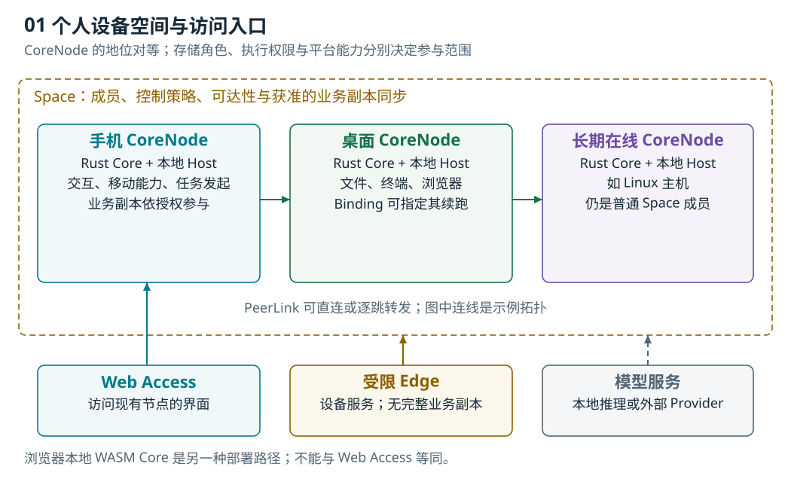
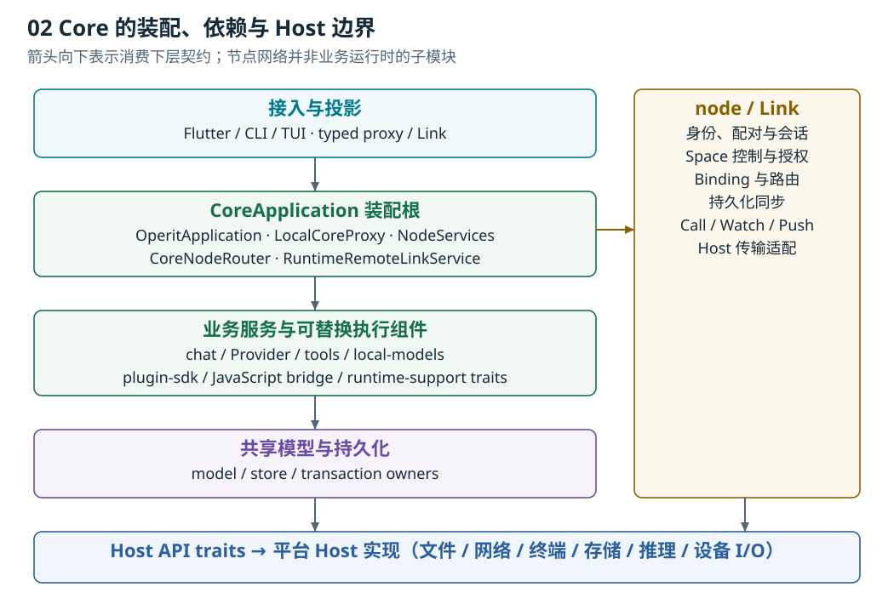
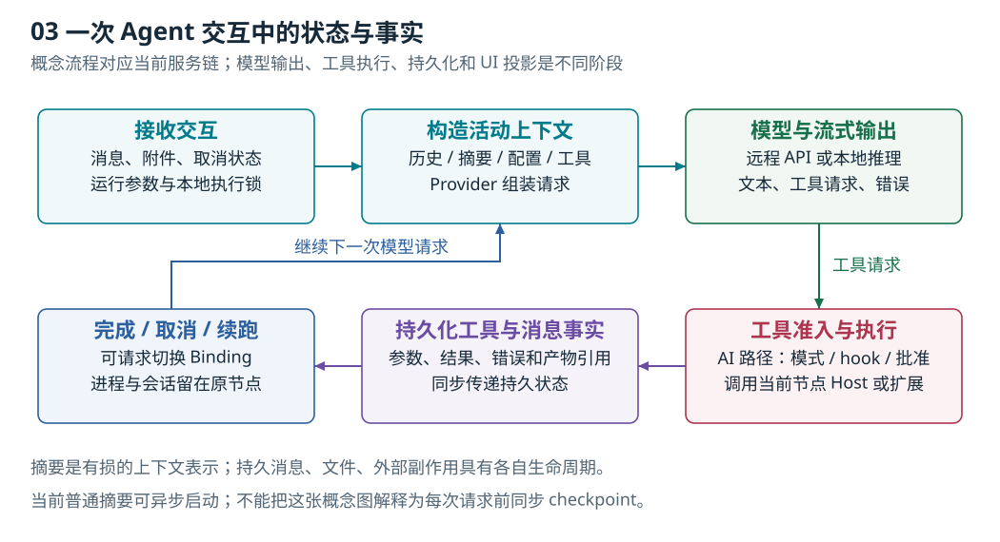
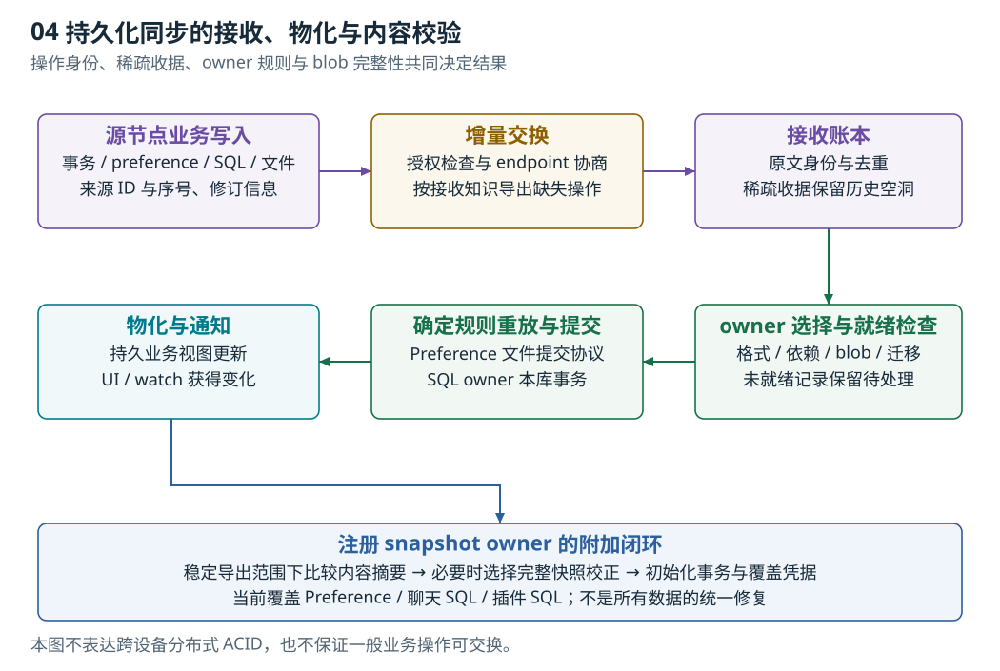
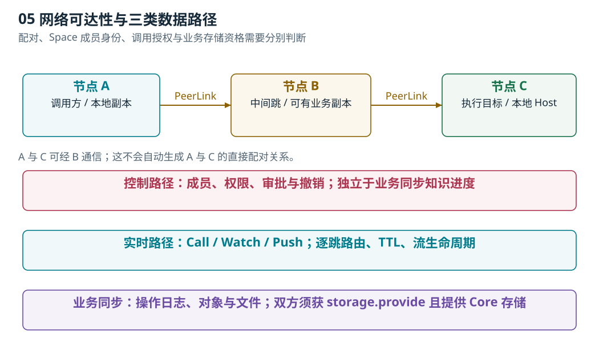
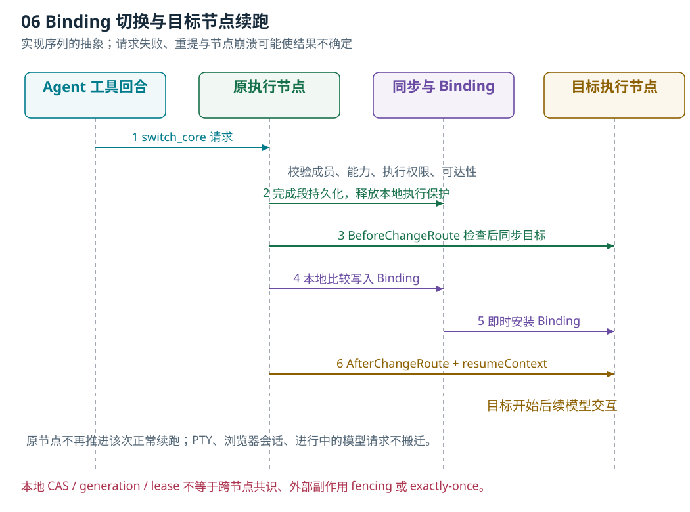
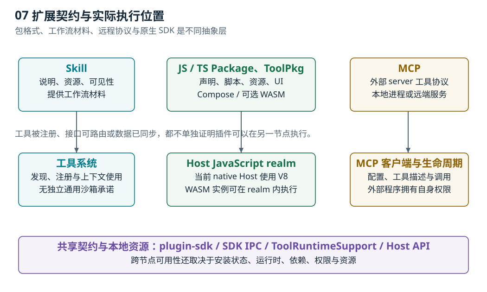
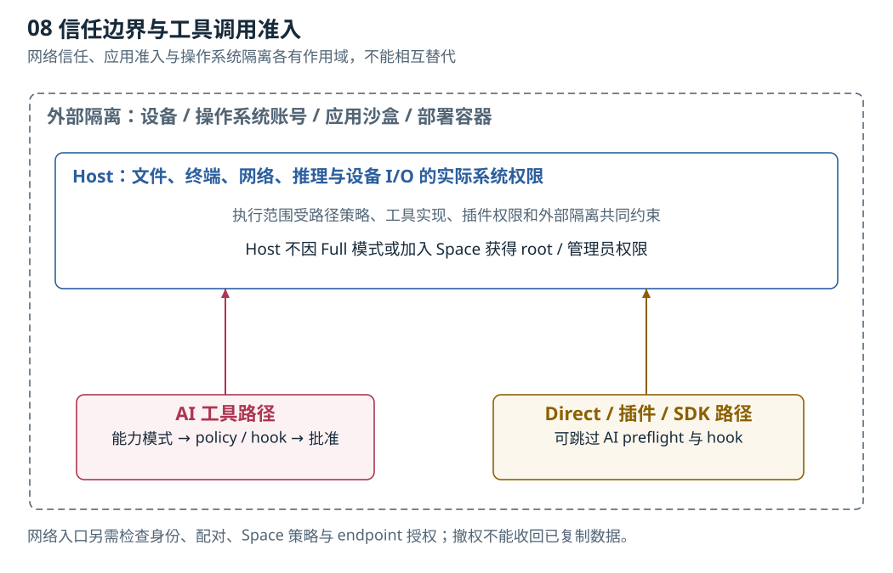
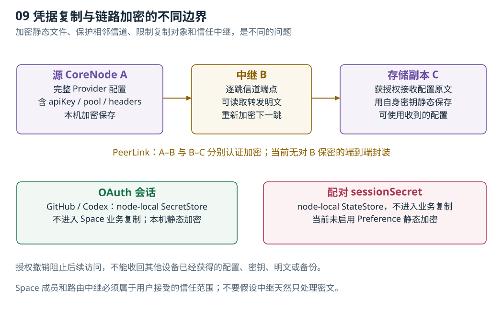

# Operit2 技术白皮书：面向个人设备空间的可持续 Agent 运行时

<!-- metadata: 中文版 2.0 | 2026-11-07 | commit 1ef788456713e0502688dc0b7928511d98b813ec -->

## 摘要

大语言模型驱动的 Agent 已能通过工具完成文件操作、程序执行和外部服务调用，但把一次交互扩展为跨会话、跨设备的个人工作过程，仍需要解决模型能力之外的系统问题：业务状态如何保存与复制，执行位置如何改变，本机能力如何暴露，授权如何传播，以及失败后能够依据什么继续工作。Operit2 将这些问题组织为一个以 Rust Core 为业务核心、以平台 Host 为能力边界、以 Space 为成员与授权协作范围的个人 Agent 运行时。

本文以 2026 年 11 月 7 日的仓库提交 `1ef788456713e0502688dc0b7928511d98b813ec` 为代码基线，结合相关论文、协议规范和开源系统，重新描述 Operit2 的系统模型与实现。系统通过不可变操作原文、精确接收收据、领域 owner 重放、本地提交协议和部分数据集的内容校正复制持久业务状态；通过 Binding 记录后续执行节点，并在已经保存的交互边界传递续跑上下文。插件 SDK、JavaScript/WASM、Skill、MCP 和生成式代理接口扩展了模型、工具与前端接入方式。

本文将代码可见机制与待验证性质区分：数据副本趋同不等于全局唯一执行，本地执行锁不等于分布式租约，回合边界续跑不等于活动进程迁移，应用工具准入不等于操作系统沙箱。当前代码已具备多节点通信、持久同步、显式执行位置切换与多平台接入的工程实现，但跨平台故障恢复、对抗性隔离、外部副作用幂等性和规模边界仍需系统实验。本文给出可追踪的实现证据、故障分析及后续评价方法，不报告本轮未实际执行的基准结果。

**关键词：** 大语言模型 Agent；个人设备空间；持久化运行时；多副本同步；跨节点续跑；Host 抽象；工具授权；可扩展系统。

### 文档范围与阅读方式

本文属于系统设计与实现白皮书，采用研究论文的问题定义、相关工作、机制分析和可复现性结构。其贡献是对工程系统的建模与证据整理，不声称提出新的共识算法、通用 CRDT、模型训练方法或已经完成同行评审的研究结论。原论文中的实验成绩和其他项目的产品声明均不作为 Operit2 的实测结果。

| 读者 | 建议阅读 | 可以据此判断的内容 |
| --- | --- | --- |
| 用户及潜在合作方 | 第 1、3、9、10、12 节 | 使用场景、设备职责、部署边界、风险与长期方向 |
| 开发者及技术评审 | 第 4 至 11 节、附录 A | 调用链、状态所有权、复制与故障语义、扩展和平台限制 |
| 研究者 | 第 2、3、6、7、11、12 节 | 与既有工作的关系、系统假设、待验证性质及实验方法 |

文中“已实现”表示可以追踪到当前生产调用路径；“部分实现”表示机制存在但适用范围或集成不完整；“规划”表示设计方向；“待验证”表示本轮没有运行足以支持该性质的实验。这些状态可以同时成立：一个功能可以已经实现，而其跨平台可靠性仍待验证。附录 A 使用 [C01] 等编号定位代码证据，参考文献使用 [1] 等编号。更细的静态审查记录保存在本目录的 `research/`。

<!-- toc -->

## 1 引言与问题定义

### 1.1 从一次模型调用到连续的个人工作

一次工具调用可以成功返回，整个任务却未必可持续。用户可能在手机上发起研究，在桌面上审核文件，再由长期在线的主机执行耗时步骤。设备的网络、权限、可用软件与电源状态并不相同；模型请求、终端进程与浏览器会话又具有不同生命周期。仅同步聊天文本无法回答哪个设备应继续执行，也不能证明工作区文件、工具结果和授权状态已经可用。

本文研究的核心问题是：在由个人控制的异构设备集合中，如何让 Agent 的持久工作状态与具体设备的暂态执行资源分离，使用户能够理解、控制并在合适的边界继续工作。这里的“持续”指可保存、可解释、可恢复的业务过程，不意味着永不终止、所有操作自动重试，或任意故障下都保持服务可用。

一个代表性场景是：手机提交“整理项目资料并生成报告”，桌面提供代码工作区，Linux 节点提供长时计算。系统需要记录消息和产物、识别目标节点是否可执行、明确当前工作的位置，并在网络变化后保留足够的恢复依据。模型能否制定正确计划与运行时能否正确保存、授权和执行，是两个需要分别评价的问题。

### 1.2 设计目标

Operit2 的设计目标可以归纳为四项。第一，个人业务数据具有独立于某次模型请求和某个前端页面的持久生命周期。第二，平台能力通过显式 Host 契约提供，跨设备执行仍受目标设备的权限与资源约束。第三，成员关系、复制范围、网络路由与执行位置分别建模，避免用“连接成功”代替所有权限判断。第四，在能够解释的业务边界继续执行，并暴露失败和不确定性，而不是把活动系统状态抽象成可以任意搬运的聊天对象。

系统面向个人及其授权设备组成的小规模协作空间。企业多租户治理、跨组织资源市场、全球一致的任务调度、任意恶意成员下的拜占庭容错，以及大规模集群吞吐，不是当前已验证的能力。对模型行为、工具结果真实性和外部服务的可用性，运行时也不能提供无条件保证。

### 1.3 本文的工程贡献与论证方式

本文整理三项可审查的工程组合：一是由 CoreApplication、类型化代理和 Host trait 构成的跨平台装配结构；二是按领域 owner 管理原文、物化、迁移、收据和内容校正的持久同步管线；三是以 Binding 和回合边界续跑上下文连接多设备执行的位置模型。它们与已有 Agent 编排、文件同步和工作流系统存在交集，本文不把这些单项能力描述为独创。

论证以生产调用链为主，测试源和设计文档为辅。代码显示“做了什么”，测试源显示“试图验收什么”，设计文档显示“希望达到什么”；三者不能互相替代。本轮没有执行项目编译、构建、测试、部署或模型任务实验，因此不会把历史测试数量或局部跑分重新包装为当前结论。

## 2 相关工作与技术位置

### 2.1 工具使用与上下文管理

ReAct 将推理、动作和环境观察交错组织，使模型能够利用外部反馈调整行为 [1]。Toolformer 通过筛选 API 调用训练样本改善模型使用工具的能力 [2]。这两类工作分别关注交互范式和模型训练。Operit2 处于工具调用的系统执行层：接入 Provider、准备上下文、实施准入、执行工具、记录结果并管理生命周期；存在工具循环并不表示复现了上述论文的方法和实验结果。

MemGPT 区分有限主上下文和外部历史/归档存储，强调需要通过检索把外部信息重新带入模型输入 [3]。这一分层有助于区分 Operit2 的原始消息、摘要、插件记忆、检索索引与当前请求。持久保存并不等于随时准确召回，摘要也不等于无损检查点。当前 Letta Code 官方仓库还描述本地或云端后端及远程计算机能力 [18]，因此本地运行、长期记忆和远程设备不宜被用作未经限定的独有性主张。

### 2.2 多副本数据与可恢复工作流

Local-first software 提出本地副本、多设备使用、离线能力、长期访问和用户控制等设计理想 [4]。这些理想为个人设备空间提供动机，却不要求把所有敏感数据复制到所有设备，也不意味着远程模型在离线时可用。Automerge 将 CRDT 数据结构、压缩格式与同步协议组合成通用库 [7]；Operit2 当前采用领域 owner、确定规则重放与特定内容校正，不能仅因存在日志和冲突处理就被归类为通用 CRDT。

CRDT 的强最终一致性包含最终交付、方法终止与强收敛：已经交付同一组更新的正确副本应具有等价状态。状态式 CRDT 通过半格上的单调更新和最小上界合并建立充分条件，操作式 CRDT 则依赖其交付与操作交换条件 [5]。Lamport 的事件顺序模型区分因果偏序、逻辑时间和额外构造的全序 [6]。因此，收到原文、应用操作、业务内容一致与外部副作用只发生一次，分别需要不同机制和证据；确定性的冲突胜者也不必等同于现实中更晚的用户意图。

LangGraph 以图状态、检查点、步骤结果和人类介入组织长期工作流 [8–10]。checkpointer 在 super-step 边界保存图状态，并记录步骤内已完成节点的 pending writes；跨线程数据则由 store 管理。其 Functional API 恢复从入口重放，复用已保存 task 结果；尚未完成记录的 task 仍可能重新执行。Temporal 将可重放的工作流历史与执行外部操作的 Activity 分开，并明确指出“完成被观察一次”不意味着外部操作只运行一次 [11–12]。Operit2 保存的是具体业务状态和续跑上下文，其回合边界交接与图检查点或工作流重放的恢复单位不同；三者都需要处理外部操作成功但完成记录未持久化的窗口。

### 2.3 协议与基础设施的职责比较

| 系统或规范 | 主要抽象及机制 | 与 Operit2 的关系及区别 |
| --- | --- | --- |
| ReAct / Toolformer [1–2] | 推理行动交互；工具使用训练 | 为 Agent 背景提供依据；持久同步和节点权限由运行时另行提供 |
| MemGPT / Letta [3, 18] | 上下文、外部记忆与持续 Agent | 共享持久状态与上下文分层问题；具体产品能力随版本变化 |
| Automerge [7] | 可并发合并的数据结构与同步库 | 以通用数据类型表达合并；当前 owner 管线定义领域提交与校正规则 |
| LangGraph [8–10] | 图状态、thread、checkpointer、重放 | 关注应用工作流；设备成员、Host 和领域副本是另一维度 |
| Temporal [11–12] | 服务端持久编排、Workflow / Activity / Worker | 故障恢复与幂等性的重要参照；服务端协调与个人节点的部署假设不同 |
| MCP [13–14] | Host / Client / Server，工具及上下文互操作 | 是工具系统接入协议；MCP Host 与 Operit2 平台 Host 分属不同抽象 |
| A2A [15] | Agent Card、Task、Message、Artifact | 面向可能不透明的外部 Agent；其任务协作与 Space 的成员和复制范围分别管理 |
| Syncthing [16] | 文件块索引、内容寻址与文件复制 | 在文件层交换元数据和块；业务 owner 另行定义事务及执行语义 |
| iroh [17] | 端点身份与连接基础设施 | 提供连接层参照；业务授权、复制和执行恢复位于上层 |

MCP 引用固定为 2025-11-25 规范版本 [13–14]。A2A 使用检索时的官方规范 [15]，本文只讨论协议职责，不据此声称 Operit2 实现全部规范。Syncthing 与 iroh 的官方资料 [16–17] 也仅用于机制对照；本文没有进行这些项目之间的性能竞赛，也没有推定本项目采用其实现。

## 3 系统模型与假设

### 3.1 CoreNode、Space 与 Host

**CoreNode** 是运行完整 Operit Core 的应用实例；CoreApplication 在装配根组合业务运行时、本地代理、节点路由和访问服务 [C01]。**Host** 是该实例使用的具体平台能力实现集合，通过 HostManager 注入文件、存储、网络、终端、浏览器、推理与设备 I/O 等 trait [C02]。节点存在某个能力描述不等于已获得相应操作系统权限。

**Space** 是成员、控制策略、可达性与获授权业务复制的范围。它不持有一套独立的全局 Agent 进程，也不是统一内存、共享 root 账号或容器。节点地位对等；一台长期在线 Linux 主机可以承担更多执行，但监听连接、转发流量或保存业务副本不使其自动成为全局主节点。

**Binding** 是业务 key 到后续执行节点的映射。当前记录字段为 `key`、`nodeId`、`generation` [C03]。聊天使用 chatId 作为 key，其业务含义由聊天服务和路由声明解释；Binding 层本身不要求 key 一定代表聊天。执行位置也不等于数据归属：多个获准副本可以保存同一聊天，下一次操作仍需路由到指定节点。

### 3.2 持久状态、暂态资源与派生表示

为分析生命周期，可以把节点的状态概念性地分成六类：业务持久数据 D，接收原文与收据 L，执行位置 B，成员与授权策略 P，Host 能力和资源 H，以及暂态执行 R。这个分类用于解释系统，不是新增的存储格式或代码类型。

| 状态类别 | 例子 | 连续性条件 |
| --- | --- | --- |
| 业务持久数据 | 聊天、配置、插件数据集、获准同步文件 | 对应 owner、格式、复制授权与所需内容可用 |
| 原文与接收知识 | 不可变操作、来源序号、精确收据、覆盖身份 | 原文身份一致，收据没有把历史空洞当作已接收 |
| 执行位置 | Binding key、目标节点、generation | 当前记录和路由可解析，目标具备权限与执行能力 |
| 控制策略 | 成员、角色、授权、审批与撤销 | 从有效控制日志重放，传播可能具有延迟 |
| Host 与本地资源 | 本机权限、已安装权重、软件、工作区挂载 | 目标节点独立满足；同步引用不自动安装资源 |
| 暂态执行 | 模型请求、PTY、WebView、流与内存句柄 | 留在原运行时；重连、重新附着和重建需各自机制 |

摘要和搜索索引属于从持久信息生成的表示。摘要可能遗漏事实；索引需要与源版本、embedding Provider 和维度一致。保存摘要、同步索引与备份原始材料，是不同的数据管理决策。

### 3.3 运行与故障假设

节点可以断连、暂停、重启或在任意步骤失败；消息可能重复、迟到或在处理后丢失响应。当前协议认证相邻配对节点，并依据本地控制投影检查路由信封中的成员、来源、目标和授权。多跳中继会解密并重新发送请求，因此本文将获授权副本和中继置于用户接受的信任范围内，没有证明在任意恶意成员、密钥泄漏或被攻陷 Host 下仍能保持数据正确。数据复制还依赖可用磁盘、兼容的格式与 codec、正确的 owner 实现以及必要的 blob；凭据与配置的具体复制范围见第 10 节。

当前架构以最终传播和具体业务规则处理多副本状态，不提供全部跨节点操作的线性一致性。离线设备可以持有旧的成员投影、配置和 Binding；在授权传播前后如何接纳操作，必须按实际入口判断。任何“已撤销”“已迁移”“已同步完成”的用户提示，都应说明其确认范围。

## 4 软件架构与装配边界

### 4.1 Rust Core 与依赖方向

仓库按 foundation、persistence、provider、tool、plugin、runtime、node、proxy、application 和 command 等领域组织 crate。CoreApplication 是组合根，构造 OperitApplication 和 LocalCoreProxy，装配 CoreNodeRouter、RuntimeRemoteLinkService、NodeServices 及可选插件 SDK IPC；通信服务注入后启动 Space 同步 [C01]。完整节点的装配关系比某个单独的聊天类或服务更能代表系统边界。

下层 crate 通过数据类型、服务和 trait 暴露契约，上层 runtime 注入应用相关行为。例如工具系统通过 ToolRuntimeSupport 请求路由变更、聊天、语音和插件资源等应用能力；Provider 和 local-models 通过各自 runtime-support trait 取得应用状态。这样的依赖反转允许工具、模型和平台实现分开演进，但并不意味着所有内部接口已经稳定或所有实现都可以热替换。

### 4.2 代理与前端职责

生成工具扫描公开服务表面，生成 Rust/Dart 投影和分发代码。LocalCoreProxy 提供统一的 Call、Watch、Push 接口 [C04]；前端消费业务服务和事件，而不是重新实现文件系统、HTTP 或节点权限。代理负责类型、序列化与传输接入，领域规则仍由业务 owner 承担。

Flutter 是图形接入面，也可以承载本地 Core。CLI/TUI 提供本地执行和运维入口。控制界面的所在地、完整 Core 的所在地、聊天 Binding 的目标，以及模型实际推理的位置，可能是四个不同位置。界面应避免把“远程执行”简单解释为“使用云模型”，也不能把“本地模型”解释为所有工具和数据均留在本机。

### 4.3 Host 的能力和生命周期

Host API 将操作请求交给实际平台实现。终端 Host 拥有 PTY 与进程，界面拥有输入和显示；工作区浏览器的真实 WebView 由 runtime owner 管理，控制端可通过服务与事件显示投影 [C02, C05]。关闭某个界面视图、停止观察事件与终止底层执行，需要使用不同生命周期动作。

Host 的存在也不是隔离证明。运行时可能提供路径约束、准入和取消机制，而进程权限、文件访问、网络能力及内存隔离最终仍由操作系统和部署环境决定。一个 Host trait 的可调用性不能替代对当前账号、平台签名、浏览器权限或设备授权的核查。

## 5 Agent 执行、上下文与记忆

### 5.1 交互闭环及结果事实

一次交互包含输入提交、活动上下文构造、Provider 请求、输出接收、工具执行、结果保存以及后续请求或结束。工具结果既可能被展示，也可能进入下一次模型上下文；持久消息和产物引用为后续继续提供依据。图 3 表示概念闭环，不要求所有 Provider 共享完全相同的流格式或每一步均跨节点事务提交。

当前模型响应中的工具批次按序执行，每个调用完成后整理对应结果；多个 tool call 不表示自动并行执行。运行时通过显式循环推进模型与工具轮次，并在轮次边界检查执行 context 是否仍有效 [C43]。不同会话、Provider 配额和 native 推理还具有各自的并发边界。

本地 ChatExecutionLease 使用共享 store 的内存互斥状态，拒绝同一聊天的已知并发执行并保护特定 revision [C06]。guard 使用本地执行 id 避免旧回调释放新执行。这对取消、错误清理和并发修改很重要，但它没有跨节点仲裁、续约或外部服务验证的 fencing token，不能用来证明分区期间只有一台设备执行。

运行时区分执行与观察。ChatSendStream 的观察句柄可以被释放，底层任务是否继续则取决于明确的取消与任务所有权 [C07]。取消请求还需要穿过 Provider、Host 和工具实现；某一层停止接收输出，不能证明外部命令、远端服务或 native 推理已即时停止。

### 5.2 Provider 与推理位置

Provider 负责把应用的请求、历史与工具接口投影为具体模型协议。当前本地文本推理由 llama.cpp 与 MNN CPU driver 提供，模型以独立资产安装、校验并登记 [C08]。模型文件大小不等于完整运行内存；工具调用格式、长上下文和语言能力也取决于具体模型及模板。

当前 LocalModelProvider 获取完整生成文本后构造响应块，不应称为逐 token 流式生成；native 推理入口没有贯通同一取消 token，因此不能承诺 UI 取消会立即终止底层计算。当前接口还拒绝 GPU 设置，不能写成已提供通用 GPU 或多模态本地推理。

LocalLlmService 为推理建立独立的 Binding，可让聊天留在当前节点而把推理发往另一具备权重的节点 [C09]。这说明“切换聊天执行节点”与“选择模型推理节点”是不同操作。模型引用被同步，不代表目标已经下载权重。浏览器 WASM 不能在本地调用这些 native LLM 后端，但可以通过 Binding 使用另一 native 节点；此时请求上下文会发送给推理节点。

本地语音识别与语音合成使用另一组 STT/TTS 会话和资产契约。桌面路径可调用已安装的 Sherpa 引擎；移动平台与浏览器通过 LocalInferenceHost 接入平台实现，浏览器使用专用 Web 模型包 [C44]。文本生成、语音识别、语音合成和音频播放具有不同的模型资产、格式及 Host 生命周期，支持其中一种不能作为其他路径已经可用的证据。

### 5.3 摘要压缩的当前实现

当前聊天历史管理从最后一条 summary 及后续消息构造活动窗口；AIMessageManager 生成普通 summary 内容，并含对近期对话的回顾 [C10]。摘要改变送入模型的工作表示，不等同于删除原始消息或建立完整可审计归档。

MessageCoordinationDelegate 可以在发送前达到阈值时启动摘要任务，而普通发送路径不等待该任务完成；回复后也可以触发摘要。摘要由 Host 调度并具有任务注册、共享完成状态和取消清理。手动摘要等待任务完成；token-limit 续跑还会校验当前 turn 并保留原执行 lease [C11]。因此不应把现有实现描述为“每次模型请求前同步完成检查点”。

结构化 boundary 元数据、独立保留的最近完整工具回合组、基于精确同步水位的接管验证以及统一恢复读文件提示，属于需要进一步实现或核实的设计方向。摘要模板校验只保证输出具备所需文本结构，不能证明用户约束、工具事实与未完成任务被完整保留。对其评价应包含事实保留和错误引入率，而不仅是压缩比。

### 5.4 插件记忆与检索

当前角色记忆的重要实现位于 `character_cards` 插件，而非一个包办所有知识的 Core 记忆子系统。源记录、embedding、派生索引和召回提示分别管理；USearch WASM 为近邻检索提供执行能力 [C12]。检索结合词项、标签、语义和有界单跳关系信号，并对部分候选进行精确重排。实际执行向量检索时，相关源向量缺失、过期或 Provider/维度不匹配会使直接查询报错并要求显式重建。

召回 hook 按参与者与聊天范围，从用户文本构造查询，将有界的记忆内容注入当前请求。它不是模型权重更新，也不表示每条持久记录都会自动进入所有请求。记忆抽取、后台任务和重建还需要正确区分产生该条记录的节点、任务所有权及源版本。对用户而言，应能追溯记录来源、修改和删除，而不能只展示一个无法解释的“记住了”状态。

当前可选召回 hook 捕获查询异常、记录错误并放弃本次注入；这与直接记忆查询或重建的错误返回不同。它也跳过缺少明确角色执行身份的请求。因此，当前实现不能被描述为每次模型请求必定获得完整记忆，评价时应同时记录召回是否实际发生及其失败原因 [C12]。

## 6 持久化复制、事务与内容校正

### 6.1 操作原文、接收知识和物化状态

SyncOperation 的原文信封包含 opId、originDeviceId、sequence、domain、entityType、entityId、operation、semantics、payload、createdAt 和 schemaVersion [C13]。同一操作身份必须对应同一不可变原文；相同 ID 的不同内容应被判为冲突。语义标记可以区分实体状态与有序 transaction，但不因此承诺跨数据集原子性。

SyncClock 表示按来源观察到的进度；SyncReceipt 使用精确区间表达已经接收的操作。若先收到同一来源的第 2 条操作，不能据此宣称第 1 条已接收。稀疏收据保留历史空洞，使后续导出仍有机会补齐。收到并保存原文、owner 成功应用，以及两端内容一致，是三个不同阶段，不能用同一个“同步成功”标记替代。

为明确这些阶段，可将一条操作的接收状态记为 R、待处理状态记为 P、业务已应用状态记为 A、已被初始化基线覆盖的身份记为 K；M 表示当前物化业务内容。这些是分析记号，不是新增数据库列。接收顺序不要求 R 与 A 同步推进；未知格式或缺失依赖可以使操作长期停留在 P。身份进入 K 需要已提交的替代表示和覆盖证据，不能仅由墙上时钟推定。

| 对象或性质 | 需要维护的条件 | 不能据此推出的结论 |
| --- | --- | --- |
| 不可变身份 | 同一 opId 重复出现时原文必须相同 | 内容相同但身份不同的外部动作只会执行一次 |
| 精确接收 R | 声明某来源区间前，区间内身份确实已接收 | owner 已解码或应用其中全部操作 |
| 应用 A 与待处理 P | 应用完成须有 owner 提交依据；未就绪状态可追踪 | 所有 owner 都会在有限时间内就绪 |
| 覆盖 K | 替代基线、必要指纹与准确覆盖集合共同保存 | 任意未交换的离线旧操作都应忽略 |
| 物化 M | 相同基线、有效历史、版本和确定 owner 规则应得到相同内容 | 在这些前提尚未齐备时，全网实时强一致 |

上表表达设计与实现需要检验的安全条件，不是已完成的形式化证明。活性还依赖消息最终可达、磁盘可写、格式可处理、依赖能补齐及调度持续推进；代码具有重试和 pending 管理，并不能独自证明这些环境条件总成立。

### 6.2 排序与领域 owner

当前事务排序对同一 origin 优先保持 sequence，对跨 origin 的队头按 Revision 选择确定顺序；一般同步操作还有 createdAt、originDeviceId 和 sequence 的冲突次序 [C14]。这可以说明同一输入集合如何得到可重复的排序，不能由“有向量时钟”推导所有跨作者依赖都已表达，也不能将 createdAt 当作绝对可信的现实先后。

Registry 将数据归属交给领域 owner。Participant 可以提供 prepare、validate、apply、project、snapshot、coverage、content_digest 和 repair 等能力；Source 提供收据、导出与 inventory [C15]。接收内核先保存原文，再按 owner 处理 pending。可重试的格式、依赖、blob 或迁移问题保留待处理；无法按当前能力应用的操作还可能标为 skipped，等待具有相应能力的内容校正路径。已明确退休的来源则按空效果确认。因此原文已存储、当前已应用和已被覆盖或跳过必须分别解释。

该结构使偏好、聊天 SQL、插件数据集、Binding 和文件可共享接收组织方式，同时保留各自的合并及提交规则。它不是一个跨全部文件和数据库的 ACID 事务管理器。独立 owner 的错误可以不阻断其他 owner，但跨 owner 的业务引用仍需显式规则维护。

### 6.3 本地原子提交与可恢复文件提交

聊天 SQL 的本地业务修改、同步 payload、来源序号和观察记录可在同一 SQLite transaction 内提交；接收远端修改也在同库内处理业务、原文和收据 [C16]。这个原子边界是明确且有价值的，但范围是对应数据库，不包括远端节点和外部系统。

Preference owner 处理另一种边界：文件内容和 SQL 账本并非天然处于同一个底层事务。当前实现先保存 FileCommit 意图，包含原文、完成或覆盖身份、别名、版本与必要内容，再把恢复依据提交到 SQL，最后清理意图 [C17]。重开时可以依据残留意图重复恢复提交。这是一套可恢复过程，评价重点应是每个失败点的恢复后状态，而不是把它称为文件与 SQLite 的原生单事务。

### 6.4 迁移、删除和历史压缩

迁移需要同时解释数据值、身份、修订、删除事实、引用和历史覆盖；只转换最终 JSON 字段不足以保证迟到操作仍正确。当前迁移内核携带 before/after、源目标 owner、原始 transaction 和历史上下文，并对受支持的 scope 和增量贡献作校验 [C18]。这些机制不能替代每个业务 owner 的版本兼容测试。

压缩使用包含完整 Snapshot 和 covered 身份的初始化事务，为已覆盖原文提供替代表示。对明确支持的绝对 Set/Delete scope，可以识别被后继操作完整覆盖的事务；无法证明整体效果已被覆盖时应保留 [C19]。例如，事务 T1 同时写入 x 与 y，之后 T2 只覆盖 x，不能仅因 x 有更新就删除整个 T1。复杂增量和引用关系也不能直接套用绝对赋值的压缩规则。

压缩可以删除旧 payload，但保留覆盖身份、必要指纹及收据。这意味着业务可恢复性、全部原始内容永久保留和法证审计是不同保留策略。删除事实可以防止旧同步记录复活对象，却不能证明已从离线副本、导出备份和外部服务物理擦除。

### 6.5 内容摘要和完整快照校正

仅比较已交换日志的进度可能遗漏物化错误。当前 consistencyVersion 6 路径在各端报告范围与本轮导出边界稳定时比较 owner 内容摘要；期间出现新事务则不宣称该轮结束。发生不一致时，按 owner 规则选择来源，传递完整快照和覆盖依据，检查 snapshot token，分别安装后再次比较 [C20]。

这一机制已经进入生产装配，但适用范围有限：Preference、聊天 SQL 和已安装插件 SQL 提供 snapshot/repair；动态 Binding、控制和普通 runtime_file Participant 当前没有统一 snapshot/repair [C15]。内容校正还是一次按业务修订及 owner 规则选定权威内容的恢复操作，不能被描述为保留所有并发意图的无损合并。

### 6.6 文件、blob 与同步成本

普通文件按路径及对应冲突规则物化完整内容，不是任意文件的实时语义协同编辑。大载荷可通过内容引用和 blob 传输，校验 SHA-256 与声明大小；工作区文件写入还具有 pending 意图和 inventory 更新步骤 [C21]。终端或外部应用的修改需要扫描等发现机制，不能认为每次写入都会被即时观察。

当前同步实现有每 peer 的 gate、摘要门控、pending 与失败计数，使用有限退避和分页预算；默认导出页预算为 4 MiB，单 pass 最多 64 页，超过后继续保留 pending [C22]。这些是控制工作量的实现参数，不是吞吐、完成时延或规模的性能结论。持续写入、大量小文件和大 blob 需要分开测量。

## 7 节点通信、路由与执行位置切换

### 7.1 三条需要区分的路径

配对建立直接连接的信任基础，Space 接纳决定协作范围，授权决定具体操作和复制资格。即使两台设备都可达，也可能不允许业务存储或某个 endpoint 调用。当前同步先交换控制，再交换设备自有配置，之后才检查双方是否具备 storage.provide 且实际提供 Core 存储服务 [C22]。控制传播独立于业务复制进度，避免撤权或新授权被业务时钟错误掩盖。

实时 Link 提供 Call、Watch 和 Push。路由信封包含 spaceId、originNodeId、targetNodeId、ttl、routeKind 和 payload [C23]。其中原发起者身份与目标决定授权，当前上一跳则用于逐跳验证与路由处理；经中间节点到达不意味着调用者与目标已经直接配对。

### 7.2 可达性和路由算法

CoreSpaceStore 实现 Dijkstra 风格的加权路径搜索，第一跳来自活跃直连，后续边需要有效公告和 transit 许可；转发递减 TTL 并核查相关成员状态 [C24]。算法支持 RTT、丢包及拥塞等字段的整数代价，但当前普通邻接公告尚未携带实测质量，常见发布路径主要表现为按跳数选路 [C25]。

网络最短路与执行节点选择不是同一问题。较少跳数不意味着目标有模型、软件或合适电源，也不意味着其适合处理敏感任务。基于健康、负载、费用、执行历史和用户偏好的自动调度，仍需要额外的数据采集、时效模型、策略及评价。

### 7.3 Binding 的本地更新语义

当前 compareAndSet 在进程内互斥保护下读取 Binding，并比较 expectedNodeId；目标改变时增加 generation，相同目标返回既有操作，不增加代次 [C03]。普通同步依据冲突规则更新本地记录；交接期间可以即时安装 Binding 而不推进一般业务同步时钟，避免一次实时安装误报更早原文已经接收。

这个实现没有分布式法定人数，也没有比较调用方观察到的 expected generation。两台尚未同步的设备可能各自在本地基于旧记录提交变化；后续记录选择可以收敛，已经产生的外部副作用却不会因此撤销。generation 是执行位置变更标识，不应被直接当成全网可验证的 fencing token。

### 7.4 交接的实际步骤

Agent 的 switch_core 请求先验证候选节点，真正路由变更发生在本轮需要保存的 assistant 段提交之后。源端构造 CoreRouteResumeContext，释放本地执行保护并调用路由变更；上下文包含聊天历史、workspacePath、参与者、模型覆盖与 turn options 等信息，不包含 CPU 栈、模型 KV cache、进程镜像或浏览器 cookie jar [C26]。

RuntimeRemoteLinkService 依次校验目标的成员身份、Core 能力、runtime.execute 和可达性，在当前 owner 调用 BeforeChangeRoute，与目标执行显式同步，再本地比较写入 Binding、即时安装目标记录，最后调用携带 resumeContext 的 AfterChangeRoute。目标打开本地持久聊天并重新取得执行保护；本次续跑使用源端随 resumeContext 传递的 runtimeChatHistory，执行配置和工作区目录组则在目标解析后用于后续交互 [C27]。因此，传递历史、同步本地副本与准备目标资源是分别发生的步骤。

工具结果已保存、下一次模型请求尚未开始，是正常交接的业务边界；并不要求交接前必定压缩摘要。workspacePath 只是上下文中的路径，目标能否访问对应文件仍取决于同步范围、挂载、Host 和实际资源。原节点的 PTY、真实 WebView、进行中的模型请求与内存对象继续留在原运行时。

### 7.5 故障窗口与重提

源端停止、同步、Binding 提交、远端安装和目标续跑没有被一个分布式事务包围。Binding 本地提交之后，目标安装或 AfterChangeRoute 仍可能失败；一次同步 pass 结束也不证明所有 owner、blob 与未来格式均已就绪。当前接口没有显式 requiredClock 或 expected generation 接管屏障参数，因此不能写成已经完成全局状态栅栏协议。

| 故障窗口 | 可以已经发生的事实 | 需要核查的恢复依据 |
| --- | --- | --- |
| 源结果保存前失败 | 工具可能已影响外部系统，结果记录可能不完整 | 外部操作身份、结果查询与源端持久日志 |
| 源结果已保存，Binding 未提交 | 正常源回合已结束，目标位置尚未变更 | 当前 Binding、源 turn 状态及是否存在待切换请求 |
| Binding 已在源端提交，目标安装失败 | 源端视图已经改变，目标可能尚无对应记录 | 双端 Binding 原文、操作身份及同步进度 |
| 目标安装成功，续跑响应丢失 | 目标可能未启动、正在运行或已完成 | 目标持久聊天、执行状态与可识别的 continuation |
| 续跑开始后目标失联 | 新模型或工具可能已被调用，取消无法由失联推定 | 目标结果、外部效果记录和后续接管协议 |

这些窗口要求区分“明确失败”和“结果未知”。当前代码在若干步骤返回错误，但本文没有证据说明所有未知状态都由统一恢复协调器自动处理；表中的恢复依据是诊断与后续协议设计应保留和验证的对象。

部分实时目标遇到特定传输错误时会排除失败第一跳并重新提交；device.tools 与 edge.* 在该层禁止自动重提，以避免“未收到回复”被当作“没有执行” [C28]。这一差别不能概括成所有调用至多一次。针对有外部副作用的业务，需要明确操作身份、可重复性、结果查询、去重存储或外部服务实施的幂等键 [12]。

## 8 扩展系统与互操作

### 8.1 分层扩展，而非单一插件概念

JavaScript/TypeScript Package 与 ToolPkg 提供声明、脚本、资源、hook 和界面等打包入口；plugin-sdk 提供格式与执行契约，工具系统管理发现和调用，runtime 注入应用服务。Skill 主要提供说明和工作流资源，MCP 提供外部工具互操作，原生 SDK/IPC 则服务于程序化接入。这些机制的执行权限和生命周期不能仅因都称为“扩展”而统一假设。

### 8.2 JavaScript 和 WASM 执行

JsEngine 通过 HostJavaScriptRuntimeHost 创建和调度执行状态，处理取消、deadline 与资源释放 [C29]。当前 native Host 使用 V8；同一拥有线程上的 runtime 可共享 isolate 和 heap，插件持有各自 context 与 microtask queue。这不能概括为每个插件独占引擎堆或独立进程。Web 路径由浏览器 worker 和浏览器自身引擎执行，终止 worker 与 native realm 内中断具有不同生命周期。

生产 ToolPkg WASM API 可在 JavaScript realm 中构建 WebAssembly.Module/Instance，保留实例内存并检查导出与内存范围；USearch 使用这一能力 [C30]。SDK 还包含另一条 scalar wasmi 路径，不能用其中一条路径概括全部 WASM。字节码格式和实例边界也不自动证明每个模块都有严格 CPU、内存、文件与网络隔离，更不等于完整 WASI 支持。

### 8.3 MCP、Skill 和跨节点依赖

当前 MCP 桥接区分本地 command 和远端 endpoint/token，HTTP 路径通过 Host 字节流处理增量响应及会话 [C31]。兼容性需要具体到传输、能力、版本和错误处理；不能从“支持 MCP”推导全部可选功能已经实现。工具描述和 annotations 是输入，不能代替信任和授权 [13–14]。

Skill 的 SKILL.md 和资源可以影响模型的工作方式，但属于可读取内容，不是经过形式验证的安全策略 [C32]。恶意或过期的说明仍可能误导模型。扩展跨节点执行还取决于包是否启用、依赖服务、Host、安装资产、资源路径和状态兼容性；同步了包引用不等于目标可以运行，更不等于可以搬迁正在执行的插件实例。

### 8.4 A2A 外部 Agent 接入

A2ARepository 将外部 Agent 连接保存在 `kind = "a2a"` 的 ExtensionRecord 中，并投影为 `a2a.{id}` 工具包，沿用包发现、启用和调用管线 [C45]。连接配置包含 URL、请求头、停用状态与 Agent Card；新安装默认属于本机，显式迁移到 Space 作用域时，这些配置字段也随安装记录共享。远端任务内容不放入连接记录，其返回 JSON 作为现有工具结果处理。外部 Agent 保持自身任务状态与执行环境，连接安装不会赋予其 CoreNode 身份或 Space 成员资格。

当前客户端实现 A2A 1.0 和 0.3 的 JSON-RPC 子集：从显式 Agent Card JSON 地址或 `/.well-known/agent-card.json` 发现元数据，按 Card 声明选择受支持的 JSONRPC 接口，并根据版本映射方法名、角色、消息字段和立即返回配置；1.0 接口声明的 tenant 会传入请求。当前生成的发送消息只包含文本 Part，其工具表面如下。

| 包工具 | 当前输入 | 协议行为与执行分类 |
| --- | --- | --- |
| `send_message` | 必填 message；可选 task_id、context_id | 创建文本消息或补充既有交互；请求立即返回 Message 或 Task，按写操作准入 |
| `get_task` | 必填 task_id | 查询远端状态、历史及交付物，按读操作准入 |
| `cancel_task` | 必填 task_id | 请求远端取消，按写操作准入；取消仍由远端任务协议决定 |

每次调用重新读取安装状态，停用后阻止后续请求；调用验证 JSON-RPC 版本与响应 ID，再返回 result。HttpHost 提供响应字节流，当前 JSON 响应累计接收上限为 8 MiB、请求等待预算为 120 秒，释放响应对象时调用对应 Host 流的关闭接口。这些是响应处理参数，不能据此推导整个网络路径的峰值内存上限或远端任务已经结束。发送和取消没有自动重提，因而失败后仍需保留对远端是否已经执行的不确定性。

携带认证请求头时，自动发现的接口必须与配置地址同源；HTTP 禁止自动跟随重定向并保持证书校验。它们减少发现过程中的凭据误送，但不构成对所有端点、插件或输入内容的安全证明。当前管线没有实现 A2A 服务端、SSE 订阅、推送通知、gRPC 或 HTTP+JSON 绑定，也未把任意多媒体 Part 暴露为发送工具参数；规范中的这些能力 [15] 应与本项目支持范围分别表述。

## 9 平台形态与部署边界

### 9.1 完整节点、访问端与能力节点

| 形态 | 当前工程角色 | 主要边界及待验证内容 |
| --- | --- | --- |
| Flutter native App | 可承载完整 Core，提供移动或桌面 UI | Host、签名、系统权限、后台生命周期各平台不同 |
| Rust CLI/TUI | 完整 Core 与本地运维入口 | 当前主机与具体 Host 决定终端、浏览器及设备能力 |
| Web Access | 控制或查看已运行 Core 的接入面 | 打开页面不自动形成一个 Space 成员 |
| 浏览器本地 WASM Core | 当前 Web 的独立本地运行路径 | OPFS、Web Locks、跨源隔离、worker 与浏览器配额约束 |
| Linux 长期在线设备 | 普通完整 CoreNode | 无中央身份特权；仍需管理系统账号、监听和凭据 |
| PB_SBC01_H3 | 通过板级 Host 启动完整 CoreApplication | 与受限微控制器不同，仍需板级资源和设备验收 |
| ESP32 等受限 Edge | 原生设备服务、有限本地配置、有界独立 HTTP 对话及可选远端 Core 消费 | 不装配完整聊天、Provider、ToolPkg 运行时及业务副本 |
| Server 方向 | 可复用 Host 与 Core 装配契约的部署方向 | 不应把目录或计划称为已交付的完整服务端产品 |

当前 Web 默认路径使用 WebWasmCoreProxy，存在浏览器本地 Core 和存储实现；不能沿用“Web 只是远程显示器”的笼统描述 [C33]。浏览器内的 v86 Linux guest 是终端工程路径，不等于可以任意操作宿主操作系统。Web Access、浏览器 Host、工作区浏览器投影和真实 WebView 也分别承担不同职责。

### 9.2 平台兼容性的含义

“目录存在”“可以编译”“接口可调用”“单平台功能通过”“跨平台交互通过”和“长期生产可用”是递进的不同证据。统一 Rust Core 可以复用业务逻辑，但无法消除移动后台挂起、桌面系统软件差异、浏览器安全模型以及板级内存上限。

iOS 终端使用独立 ARM64 Linux runtime、持久 rootfs 与绑定目录等机制 [C34]。其指令、系统调用、I/O 和并发兼容性有明确子集；在 macOS ARM64 CLI 上获得的独立 runtime 结果不能直接外推为 iOS 真机、App 整体速度或完整 Linux 容器能力。本文不将历史局部基准转列为当前跨平台性能。

### 9.3 数据备份与迁移

备份和复制都需要说明范围：身份、业务数据、工作区、插件状态、模型资产、配对与本机密钥不一定属于同一个归档或同步策略。新的设备即使恢复了聊天，也仍可能需要重新配对、安装模型、授权 Host 和准备工作区。没有副本或归档的暂态资源无法从一段总结恢复。

预览阶段的数据格式与插件契约仍可能变化。迁移的验收对象应包括迟到旧操作、离线设备重新加入、删除事实、别名、引用与压缩后的基线，而不只是新版本能否打开一份样本。版本协商或严格拒绝未知格式，比没有证据的“任意版本无缝兼容”更符合技术契约。

## 10 安全模型与授权语义

### 10.1 威胁与信任假设

需要考虑的攻击面包括：模型或网页中的提示注入，恶意或被替换扩展，被接纳但失陷的设备，凭据泄漏，路由重提引起的重复副作用，以及 CPU、内存、磁盘和流连接耗尽。个人控制设备不意味着每个输入、插件或设备都可靠；已经进入可信执行边界的原生程序尤其不能仅由聊天审批策略限制。

安全分析分为网络入口、应用准入、插件桥接和外部隔离。网络入口核查身份、配对、Space、来源、目标和 endpoint 权限；应用准入判断某次 AI 工具请求；Host 调用受平台及系统账号能力限制；容器、虚拟机、应用沙盒等才构成相应的外部隔离。不同层的有效约束不能互相替代。

### 10.2 AI 模式与用户批准

ReadOnly、WorkspaceWrite 和 Full 是 AI 工具准入策略。当前 ReadOnly 下的写操作和 WorkspaceWrite 的越界操作可以通过用户批准继续；Workspace 路径检查主要作用于写路径，读取并非统一限制在工作区内 [C35]。因此“只读模式”不宜被描述为不可覆盖的文件系统强制只读挂载。

Full 放宽应用层限制，不提升 Host 的系统权限。ALLOW_SESSION 当前按 tool.name 保存，并非对参数、路径或某个聊天逐项约束。对于需要批准且未命中既有会话授权的请求，没有交互式批准请求器时默认拒绝 [C36]。设计用户提示时，应明确本次批准的对象、作用范围、目标节点和持续时间，避免把一次批准误解为仅对某个路径有效。

### 10.3 Direct、插件信任和身份上下文

ToolExecutionPolicy 区分 Ai 与 Direct。Direct 是普通 JS/application 调用路径，可跳过 AI exposure、preflight 和 hook [C37]。这意味着插件或程序化 SDK 的安全性需要由原生身份、桥接能力、扩展权限、Host 和部署隔离共同保障；不能承诺插件内部每次工具调用都经过同一套 AI 弹窗。

当前原生边界会捕获 authenticated extension context 和任务局部 turn snapshot，并在部分 package/浮窗 route 上核验 owner 与启用状态 [C37]。这能减少只信任脚本传入身份或全局 UI 选择的混淆，但不构成对全部恶意插件的完整隔离证明。引擎 realm 和独立 worker 也不是相互独立的操作系统安全域。

### 10.4 凭据归属、静态加密与逐跳保密

当前 ProviderProfile 包含 apiKey、apiKeyPool 和 customHeaders；ModelConfigManager 将完整 Provider 序列化为可同步的 Preference 值，未剥离这些字段 [C39]。TTS/STT 配置也注册为加密的 Space owner。因此，取得相应业务存储授权且提供 Core 存储服务的节点，可以接收包含模型与语音凭据的配置。不能沿用“API keys 默认本机、加入 Space 不复制”的笼统表述。

加密 Preference 使用本机密钥静态保存，journal 导出时恢复原文，接收方再以本机密钥保存；静态加密与是否同步是两个独立维度 [C40]。GitHub/Codex OAuth 使用本机、加密的 CoreNodeSecretStore；配对 sessionSecret 也属于 node-local 数据、不进入业务复制，但当前 PeerStateStore 使用非 Preference 静态加密的 CoreNodeStateStore，仍依赖 Host 文件权限和部署保护 [C41]。不能将这些路径概括为“所有凭据均由系统安全库保管”。

PeerLink 使用配对共享凭据、每次握手的临时 X25519 密钥、派生密钥和 ChaCha20-Poly1305 认证加密保护相邻节点信道 [C42]。稳定 nodeId 不是长期签名公钥；PAKE 使用的群也不等于设备证书身份。本文没有发现可以据此声明完整设备 PKI 的实现证据。

在 A→B→C 的多跳路径中，B 是 A–B 和 B–C 两个信道的端点，会解密并重新转发路由信封和 payload。当前路径不提供对中继隐藏内容的源到目标端到端加密，也没有独立的端到端源签名用于抵抗恶意中继改写 originNodeId [C42]。因此 Space 成员和中继必须处于用户接受的信任范围内；仅具备逐跳加密不能支持“零信任中继”或“中继看不到业务数据”的承诺。

| 数据或保护机制 | 当前归属与作用 | 安全含义 |
| --- | --- | --- |
| 模型和语音 Provider 配置 | 加密 Space Preference，包含敏感字段 | 获业务复制授权的节点可读取相应配置 |
| GitHub/Codex OAuth | 本机加密 SecretStore | 不进入 Space 业务同步；仍需保护本机账号和密钥 |
| 配对 sessionSecret | 本机 StateStore，当前未启用 Preference 静态加密 | 不同步，但不能声称由 SecretStore 加密保护 |
| Preference 静态加密 | 各节点使用自身密钥保存 | 保护静态文件的方式，不阻止授权副本获取原文 |
| PeerLink 认证加密 | 相邻配对节点间的信道 | 保护该跳传输；中继是可读取明文的信任端点 |

### 10.5 授权撤销与外部副作用

Space 成员、transit、runtime.execute 和 storage.provide 对应不同授权；内置 user 与 relay 角色当前均具有 storage.provide，中继在提供相应 Core 存储服务时也参与业务复制。入口和 blob 分块路径会重新检查当前授权，但控制信息传播仍有延迟。被撤销的节点可能已经持有明文、配置密钥或备份，撤销后续访问不等于远程擦除已有数据，也不等于轮换已经复制的 Provider 凭据。

对外发送、付款、提交或删除操作还涉及系统外部的信任边界。操作超时或用户取消不能证明目标未执行。应将操作身份、意图、目标、执行结果与不确定状态留为可查询事实，并由业务协议决定是否允许再次执行。白皮书不能用加密连接、Binding 或本地日志替代这些语义。

## 11 证据、评价方法与有效性限制

### 11.1 本文已经获得的证据

本轮证据来自三个方面：实际生产代码与装配调用点、相关测试的源文件、经过读取的原始论文与官方资料。源码证据支持架构和机制分析，测试源支持识别验收意图，外部来源支持术语与设计比较。三者均不能替代当前版本的端到端实验。

| 领域 | 当前可追踪的机制或测试源 | 本轮结论的边界 |
| --- | --- | --- |
| 节点和权限 | device_space 下的加入、控制重放、撤销及 route 契约 | 表明已有针对性用例；未运行，不给通过率 |
| 复制与 blob | 稀疏收据、删除、缺块、错误 hash、路径边界用例 | 不证明所有 crash/fsync/磁盘满窗口已覆盖 |
| 事务与压缩 | 同库提交、初始化、覆盖身份及部分效果保留用例 | 不证明任意 owner 或高阶事务的通用代数 |
| 交互和取消 | task-local 身份、过期 turn、观察释放与续跑 receipt | 不证明所有 Provider/Host 都即时中断 |
| 记忆检索 | 向量来源、维度变化、scope 与后台任务 ownership | 不给事实准确率、Recall@k 或长时记忆成绩 |
| 插件与本地模型 | V8 deadline、Web worker 取消、native 推理参数用例 | 不代表跨平台恶意代码隔离或真机性能 |

已有多进程压力运行器使用隔离配置与真实传输，契约测试也具有可控请求失败和响应丢失注入 [C38]。但部分持久化用例只调用真实 store，而不启动完整 OperitApplication/background sync；运行器使用 Unix 进程信号，定向网络限制场景依赖 macOS sandbox。同宿主回环网络不等于真实 Wi-Fi、NAT、移动后台或多设备运行，历史 macOS 记录也不能替代 Windows、Linux 和移动端验证。本白皮书不复述历史日志中的通过数字作为新基线。

### 11.2 建议的可复现实验协议

**复制正确性。** 固定同一初始数据和操作脚本，产生同作者连续操作、跨作者并发写、删除、迟到、重复、乱序和历史空洞；控制网络分区与恢复。分别检查原文身份集合、精确收据、pending、覆盖元数据与规范化业务内容。只比较最终界面文本不足以发现永久缺失日志或删除复活。

**崩溃一致性。** 在业务提交、原文落盘、FileCommit 保存、SQL 恢复、意图清理、blob 发布和 snapshot 安装等步骤注入进程终止及写入失败。重启时应从冻结磁盘副本重新读取，避免复用内存缓存；检查所有独立 owner，记录无法恢复或需要人工选择的状态。磁盘满、截断和部分提交应单列。

**交接与副作用。** 在源保存、lease 释放、同步、Binding 提交、目标安装和 AfterChangeRoute 前后分别中断。使用可观测的外部计数器或支持幂等键的服务记录调用，区分“调用次数”“成功副作用次数”“已持久化完成次数”和“用户观察结果”。不能只统计目标聊天是否继续回复。

**复制范围与授权。** 使用虚构标记分别填充同步 Provider 配置、本机 OAuth 会话、配对状态及 Space/Device 插件存储，检查各类节点收到的原文与实际物化内容。分别在入网、授予或撤销 storage.provide、打开传输后撤权、退出再加入等时点记录结果；加密文件存在不能代替对接收节点实际可读范围的检查。还应观察多跳中继能够读取的信封和载荷，明确所验证的是逐跳信道还是端到端保密。

**上下文与检索。** 建立带标注的长任务语料，记录用户约束、未完成动作、精确参数和来源。报告摘要压缩比、关键事实保留率、错误引入率、检索 Recall@k/NDCG 及来源归属正确率；对抽取、召回和最终任务成功分开评价。比较无摘要、当前摘要和原文检索等可解释基线。

**平台与资源。** 分别覆盖 Windows/Linux/macOS、移动后台、浏览器 WASM/远程接入、完整板级 Core 和受限 Edge。测量 UI 首次可见、模型首响应、工具到下一请求间隔、同步收敛、空闲唤醒、传输字节、CPU/RSS、冷/热插件、模型载入及取消延迟。报告硬件、系统、模型、编译配置、样本数、预热、重复次数、百分位和失败分布。

### 11.3 指标的定义与报告要求

| 指标 | 操作性定义 | 必要控制条件 |
| --- | --- | --- |
| 同步收敛时间 | 最后一次源业务提交至全部目标 owner 内容一致的时间 | 明确副本集合、pending、写入是否停止和内容比较方法 |
| 交接时间 | 源端边界完成至目标首次后续模型请求或明确失败 | 分离同步、授权等待、模型网络时间与重复请求 |
| 任务完成率 | 按预定义可观察验收条件完成的任务比例 | 固定模型、提示、工具、数据和重试预算，公开失败分类 |
| 副作用重复率 | 同一业务意图产生超过一次外部效果的比例 | 外部独立计数，覆盖成功后丢响应和崩溃窗口 |
| 空闲同步成本 | 无业务变更时单位时间唤醒、CPU 和传输量 | 同一拓扑、连接、扫描范围和运行时长 |
| 记忆质量 | 相关记录排序与来源正确性及对任务的实际帮助 | 分开检索、摘要和模型生成，禁止以 token 少替代质量 |

### 11.4 有效性限制

静态阅读不能验证动态竞态、资源泄漏或实际部署；抽样的调用链也不能证明不存在其他入口。外部官方文档是其项目自身的功能说明，不是独立对照实验。当前代码和可变文档会继续变化，复现应固定提交、依赖和数据。个人设备空间的经验不能外推到数千节点、多租户或敌对网络；针对少量故障排列的测试也不等于形式化证明。

## 12 演进路线与开放问题

### 12.1 以明确验收条件推进的方向

| 方向 | 当前基础与差距 | 下一阶段可审查的完成条件 |
| --- | --- | --- |
| 交接与恢复协议 | 已有回合边界、Binding、显式同步与续跑；分步失败窗口仍在 | 定义接管身份和版本条件，覆盖重复 continuation、分区与每个持久点崩溃 |
| 数据契约和修复 | 已有 owner、迁移、覆盖压缩及部分 snapshot 校正 | 公布逐 owner 的 schema/合并/保留规则，验证离线旧版本重返及修复选择 |
| 上下文连续性 | 已有摘要和专门的 token-limit 续跑 | 明确 boundary 元数据与原文保留范围，用标注任务验证事实和约束保留 |
| 策略化节点选择 | 已有角色、可达性、能力与显式切换 | 提供有时效的健康/资源信号，用户约束可解释，执行记录用于可重复评价 |
| 扩展兼容性 | 已有 SDK、ToolPkg、JS/WASM、MCP 与 Skill | 声明运行时、依赖、权限、状态范围和兼容版本，在目标节点预检并准确报错 |
| 人机授权和凭据 | 已有 AI 策略、审批与网络权限 | 界面显示实际目标及批准范围，逐字段审核敏感复制、撤销和凭据轮换 |
| 平台与长期运行 | 已有多平台 Host 和专项运行器 | 发布固定版本的设备矩阵、长时资源曲线、弱网/后台/重启证据与失败清单 |

### 12.2 长期愿景

长期目标是让个人的设备能力形成可理解、可控制的工作环境：随身设备负责即时交互，桌面负责创作与审阅，常在线节点承担持续工作，受限 Edge 提供物理设备服务。设备选择可以逐渐结合能力、时效、历史证据、成本、隐私和用户偏好，但这些信号不能把高风险外部操作变成无需明确语义的自动重提。

模型、提示方法与 Agent 编排会继续变化。系统可以保持 Provider 和扩展可替换，同时长期维护用户状态、来源、授权、格式版本与恢复依据。其价值应通过减少上下文重复整理、准确延续任务、可解释地处理失败和迁移、以及用户能够掌握数据与执行位置来衡量，而不以“永不丢失”“无限记忆”或“任何设备无缝执行”作为替代指标。

### 12.3 开放研究问题

个人设备空间仍有三个值得系统研究的问题。第一，在不依赖固定中央服务的前提下，应如何描述任务接管、操作意图和外部效果之间的可验证关系。第二，模型上下文中的有损摘要如何与可查询原始事实、版本和来源协作，减少长期工作中的约束漂移。第三，如何把节点健康与能力选择组织为用户可解释的决策，并在弱网、移动后台和受限硬件上控制复制成本。本文将这些列为可实验的问题，而不是已经解决的产品承诺。

## 附录 A 源码证据与实现定位

以下定位固定于本文代码基线。行号用于复核入口；链接指向对应源码，详细行范围与分析见 [分布式审查](research/distributed-code-audit.md)、[运行时审查](research/runtime-code-audit.md) 和 [相关工作记录](research/related-work.md)。这些文件是本次文档审查材料，不是运行通过报告。

| 编号 | 源码入口 | 支撑内容 |
| --- | --- | --- |
| C01 | [CoreApplication](../../core/crates/application/core/src/lib.rs#L126) | 同一 Core 树的装配、NodeServices 与同步启动 |
| C02 | [HostManager](../../core/crates/foundation/host-api/src/HostManager.rs#L139) | 本机能力 trait 和环境描述 |
| C03 | [CoreNodeBindingStore](../../core/crates/persistence/store/src/CoreNodeBindingStore.rs#L180) | 本地 CAS、generation 与即时安装 |
| C04 | [LocalCoreProxy](../../core/crates/proxy/local/src/lib.rs#L293) | 生成投影与 Call/Watch/Push 表面 |
| C05 | [Host 边界与浏览器](../../hosts/README.md#L58) | runtime owner WebView 与控制投影 |
| C06 | [ChatExecutionLease](../../core/crates/persistence/store/src/ChatExecutionLease.rs#L7) | 本地排他、revision 及 guard 清理 |
| C07 | [ChatSendStream](../../core/crates/runtime/application/src/services/core/ChatSendStream.rs#L195) | 观察结束与有界快照测试源 |
| C08 | [LocalLlmInference](../../core/crates/provider/local-model/src/LocalLlmInference.rs#L37) | 本地推理参数、CPU 及 native 入口 |
| C09 | [LocalLlmService](../../core/crates/runtime/application/src/services/LocalLlmService.rs#L12) | 独立推理 Binding 和远程推理 |
| C10 | [AIMessageManager](../../core/crates/runtime/application/src/core/chat/AIMessageManager.rs#L522) | 当前 summary 构造与对话回顾 |
| C11 | [MessageCoordinationDelegate](../../core/crates/runtime/application/src/services/core/MessageCoordinationDelegate.rs#L808) | 异步摘要、手动等待及 token-limit 续跑 |
| C12 | [memory-search](../../plugins/packages/buildin/character_cards/src/memory-search.ts#L9) / [memory-recall](../../plugins/packages/buildin/character_cards/src/memory-recall.ts#L14) | 混合检索与有界请求注入 |
| C13 | [SyncOperationStore](../../core/crates/persistence/store/src/SyncOperationStore.rs#L124) | 原文、不可变身份、SyncClock 与稀疏 receipt |
| C14 | [Transaction](../../core/crates/persistence/store/src/Transaction.rs#L20) | 同作者 sequence 与跨作者确定排序 |
| C15 | [应用 SyncConsistency](../../core/crates/runtime/application/src/core/application/SyncConsistency.rs#L25) | owner 装配及 snapshot/repair 的实际覆盖 |
| C16 | [SqlChatSyncStore](../../core/crates/persistence/store/src/sync/SqlChatSyncStore.rs#L599) | 聊天修改、原文及收据的同库事务 |
| C17 | [PreferenceOwner](../../core/crates/persistence/store/src/transaction/PreferenceOwner.rs#L97) | FileCommit 意图及恢复提交 |
| C18 | [Migration](../../core/crates/persistence/store/src/transaction/Migration.rs#L45) | 迁移上下文与受支持 scope 校验 |
| C19 | [Compaction](../../core/crates/persistence/store/src/transaction/Compaction.rs#L32) | 初始化、覆盖、指纹与受限压缩规则 |
| C20 | [节点 SyncConsistency](../../core/crates/node/runtime/src/SyncConsistency.rs#L19) | v6 内容比较、边界检查与快照校正 |
| C21 | [RuntimeFileSyncStore](../../core/crates/persistence/store/src/RuntimeFileSyncStore.rs#L315) / [WorkspaceFileSyncStore](../../core/crates/persistence/store/src/WorkspaceFileSyncStore.rs#L279) | blob 完整性、pending 与文件物化 |
| C22 | [SpacePersistenceSyncService](../../core/crates/node/runtime/src/SpacePersistenceSyncService.rs#L541) | 控制/业务分离、授权、gate 与分页 |
| C23 | [Link protocol](../../core/crates/foundation/link/src/protocol.rs#L963) | RoutedCoreRequest 与流协议 |
| C24 | [CoreSpaceStore](../../core/crates/persistence/store/src/CoreSpaceStore.rs#L1001) | 加权路径搜索、成员与 transit |
| C25 | [space_topology](../../core/crates/node/runtime/src/peer/space_topology.rs#L15) | 实时质量公告的当前边界 |
| C26 | [MessageProcessingDelegate](../../core/crates/runtime/application/src/services/core/MessageProcessingDelegate.rs#L2541) / [runtime_support](../../core/crates/tool/services/src/runtime_support.rs#L18) | 源端持久化边界与 resumeContext |
| C27 | [RuntimeRemoteLinkService](../../core/crates/node/runtime/src/RuntimeRemoteLinkService.rs#L940) / [ChatServiceCore](../../core/crates/runtime/application/src/services/ChatServiceCore.rs#L794) / [sendRoutedContinuation](../../core/crates/runtime/application/src/services/core/MessageCoordinationDelegate.rs#L486) | changeRoute 步骤、传递历史与目标续跑 |
| C28 | [route_forwarding](../../core/crates/node/runtime/src/route_forwarding.rs#L81) | 实时重提及目标类型限制 |
| C29 | [JsEngine](../../core/crates/plugin/javascript-bridge/src/javascript/JsEngine.rs#L309) / [native JavaScript](../../hosts/common/operit-host-native-scheduler/src/javascript_runtime.rs#L69) / [V8 context 与共享 isolate](../../hosts/common/operit-host-native-scheduler/src/javascript_engine.rs#L20) | Host 引擎调度、取消、V8 生命周期 |
| C30 | [ToolPkgWasmApi](../../core/crates/plugin/sdk/src/toolpkg/ToolPkgWasmApi.js#L67) | realm 内模块、实例及内存 |
| C31 | [MCPBridgeClient](../../core/crates/tool/services/src/tools/mcp_runtime/plugins/MCPBridgeClient.rs#L43) | local command 与 remote endpoint |
| C32 | [SkillManager](../../core/crates/tool/services/src/tools/skill/SkillManager.rs#L156) | SKILL.md 与资源发现 |
| C33 | [PlatformCoreProxyWeb](../../apps/flutter/app/lib/core/bridge/PlatformCoreProxyWeb.dart#L3) | 浏览器本地 WASM Core 接入 |
| C34 | [iOS Host](../../hosts/ios/README.md#L5) / [Edge node](../../edge/sdk/node/README.md#L1) | 平台运行时及轻量节点职责 |
| C35 | [AIToolHandler](../../core/crates/tool/services/src/tools/AIToolHandler.rs#L856) | AI 模式可批准覆盖与写路径检查 |
| C36 | [ToolPermissionSystem](../../core/crates/tool/services/src/tools/ToolPermissionSystem.rs#L207) | 按工具名的 session 批准与默认拒绝 |
| C37 | [ToolExecutionManager](../../core/crates/tool/services/src/ToolExecutionManager.rs#L67) / [Direct 策略](../../core/crates/tool/services/src/tools/AIToolHandler.rs#L1095) | 身份上下文、Ai/Direct 边界 |
| C38 | [device_space 测试说明](../../core/crates/node/runtime/tests/device_space/README.md#L1) / [多进程运行器](../../apps/cli/tests/space-stress.md#L1) | 测试范围、真实传输及已知证据限制 |
| C39 | [ProviderProfile](../../core/crates/foundation/model/src/ModelConfigData.rs#L608) / [Provider 保存](../../core/crates/runtime/application/src/data/preferences/ModelConfigManager.rs#L1159) / [owner 注册](../../core/crates/runtime/application/src/data/preferences/PreferenceSpaceMerge.rs#L27) | 完整 Provider 与敏感字段参与复制 |
| C40 | [PreferencesEncryption](../../core/crates/persistence/store/src/PreferencesEncryption.rs#L12) / [journal 原文导出](../../core/crates/persistence/store/src/SyncOperationStore.rs#L1788) | 本机静态加密与传输原文的边界 |
| C41 | [PeerStateStore](../../core/crates/node/runtime/src/PeerStateStore.rs#L48) / [本机 StateStore](../../core/crates/persistence/store/src/PreferencesDataStore.rs#L2173) / [SecretStore](../../core/crates/persistence/store/src/PreferencesDataStore.rs#L2349) | 配对、OAuth 与静态保护的不同策略 |
| C42 | [peer crypto](../../core/crates/node/runtime/src/peer/crypto.rs#L253) / [路由解码](../../core/crates/node/runtime/src/peer/dispatch.rs#L53) / [邻接发送](../../core/crates/node/runtime/src/HostRuntimePeerService.rs#L660) | 逐跳信道认证加密与中继可见性 |
| C43 | [EnhancedAIService](../../core/crates/provider/services/src/chat/EnhancedAIService.rs#L2641) / [工具批次执行](../../core/crates/tool/services/src/ToolExecutionManager.rs#L358) | 模型与工具迭代循环、同响应工具串行批次 |
| C44 | [LocalModelProvider](../../core/crates/provider/local-model/src/LocalModelProvider.rs#L159) / [WebLocalInferenceHost](../../hosts/web/src/tools/local_inference/mod.rs#L24) | 本地 STT/TTS 与平台 Host 的执行分工 |
| C45 | [A2ARepository](../../core/crates/tool/services/src/tools/a2a/A2ARepository.rs#L160) / [协议映射](../../core/crates/tool/services/src/tools/a2a/A2ARepository.rs#L523) / [A2AToolExecutor](../../core/crates/tool/services/src/tools/a2a/A2AToolExecutor.rs#L58) | 外部 Agent 发现、JSON-RPC 子集、任务工具、调用限制与安装作用域 |

## 附录 B 术语与状态声明

| 术语 | 本文采用的含义 |
| --- | --- |
| Agent 运行时 | 组织模型请求、工具、上下文、状态和生命周期的软件基础，不指某个特定模型 |
| CoreNode | 装配完整 Core 的应用实例；与受限 Edge 能力节点区分 |
| owner | 决定某数据集格式、重放、迁移和提交规则的领域所有者，不表示设备管理员 |
| receipt | 已接收原文身份的精确知识，区别于业务应用完成 |
| continuation | 根据保存上下文与事实启动后续执行，区别于恢复 CPU 栈或活动连接 |
| 本地执行保护 | 当前 store/进程已知并发执行的排他与 revision 保护 |
| 内容校正 | 按明确规则选择并安装完整 owner 快照的恢复步骤 |
| capability 描述 | 运行环境或协议的能力信息，不能单独视作系统权限或安全证明 |
| 规划与待验证 | 前者缺少完成的实现契约，后者缺少足够实验证据；两者分别标识 |

本文所述 Core crate 的 workspace license 为 MIT；仓库根许可证为 AGPL-3.0。插件、模型、第三方库和分发资产具有各自许可，不能把 Core 的许可证扩大为全部仓库或全部模型的授权。具体使用应查相应许可证、manifest 和第三方声明。

## 参考文献

下列网络资料访问日期均为 2026-11-07。论文年份按其正式发表或预印本记录；持续更新的开源仓库和官方文档不虚构出版年份。文献核查及版本差异见 `research/related-work.md`。

[1] Yao, S., Zhao, J., Yu, D., et al. **ReAct: Synergizing Reasoning and Acting in Language Models**. ICLR, 2023. [原文 v3](https://arxiv.org/html/2210.03629v3). DOI: 10.48550/arXiv.2210.03629.

[2] Schick, T., Dwivedi-Yu, J., Dessì, R., et al. **Toolformer: Language Models Can Teach Themselves to Use Tools**. NeurIPS, 2023. [原文 v1](https://arxiv.org/html/2302.04761v1). DOI: 10.48550/arXiv.2302.04761.

[3] Packer, C., Wooders, S., Lin, K., et al. **MemGPT: Towards LLMs as Operating Systems**. arXiv:2310.08560, 2023; 核查修订版 v2, 2024. [原文 v2](https://arxiv.org/html/2310.08560v2). DOI: 10.48550/arXiv.2310.08560.

[4] Kleppmann, M., Wiggins, A., van Hardenberg, P., McGranaghan, M. **Local-first software: You own your data, in spite of the cloud**. Onward!, 2019. DOI: 10.1145/3359591.3359737. [作者公开全文](https://www.inkandswitch.com/essay/local-first/).

[5] Shapiro, M., Preguiça, N., Baquero, C., Zawirski, M. **Conflict-Free Replicated Data Types**. SSS, LNCS 6976, pp. 386–400, 2011. DOI: 10.1007/978-3-642-24550-3_29. [作者原文](https://asc.di.fct.unl.pt/~nmp/pubs/sss-2011.pdf).

[6] Lamport, L. **Time, Clocks, and the Ordering of Events in a Distributed System**. Communications of the ACM, 21(7):558–565, 1978. DOI: 10.1145/359545.359563. [作者原文](https://lamport.azurewebsites.net/pubs/time-clocks.pdf).

[7] Automerge contributors. **Automerge**. 官方实现与仓库说明. [仓库](https://github.com/automerge/automerge).

[8] LangChain contributors. **LangGraph**. 官方实现与仓库说明. [仓库](https://github.com/langchain-ai/langgraph).

[9] LangChain. **Checkpointers; Persistence**. LangGraph 官方文档. [Checkpointers](https://docs.langchain.com/oss/python/langgraph/checkpointers)；[Persistence](https://docs.langchain.com/oss/python/langgraph/persistence).

[10] LangChain. **Functional API**. LangGraph 官方文档，重点参考恢复、task 重放、确定性和幂等性. [文档](https://docs.langchain.com/oss/python/langgraph/functional-api).

[11] Temporal contributors. **Temporal**. 服务端官方实现. [仓库](https://github.com/temporalio/temporal).

[12] Temporal. **Activity Definition**. 官方文档，重点参考执行重试、完成观察和幂等键. [文档](https://docs.temporal.io/activity-definition).

[13] Model Context Protocol maintainers. **Model Context Protocol Specification**, revision 2025-11-25. [固定版规范](https://modelcontextprotocol.io/specification/2025-11-25)；[官方仓库](https://github.com/modelcontextprotocol/modelcontextprotocol).

[14] Model Context Protocol maintainers. **Security Best Practices**, revision 2025-11-25. [规范](https://modelcontextprotocol.io/specification/2025-11-25/basic/security_best_practices).

[15] A2A Project. **Agent2Agent Protocol Specification**. 核查时的官方规范. [规范](https://a2a-protocol.org/latest/specification/)；[官方仓库](https://github.com/a2aproject/A2A).

[16] Syncthing contributors. **Block Exchange Protocol v1**. 官方协议文档. [规范](https://docs.syncthing.net/specs/bep-v1.html)；[实现](https://github.com/syncthing/syncthing).

[17] n0 / iroh contributors. **iroh**. 官方连接基础设施与协议组合说明. [文档](https://docs.iroh.computer/)；[仓库](https://github.com/n0-computer/iroh).

[18] Letta contributors. **Letta Code**. 官方活跃实现，核查本地/云 backend 与 remote computers 说明. [仓库](https://github.com/letta-ai/letta-code).

Operit2 的工程事实来自本文固定源码基线与附录 A。项目入口：[Operit2](https://github.com/AAswordman/Operit2)。本白皮书是对当前工程的描述与评价计划，不构成未实现接口、性能指标或未来交付时间的保证。
