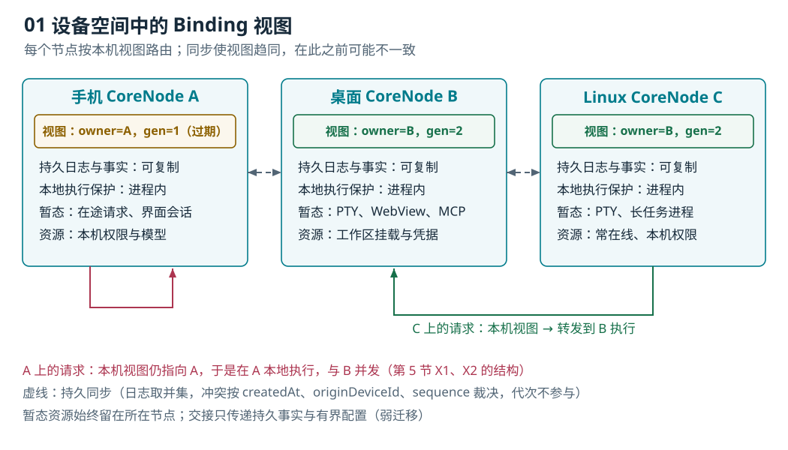
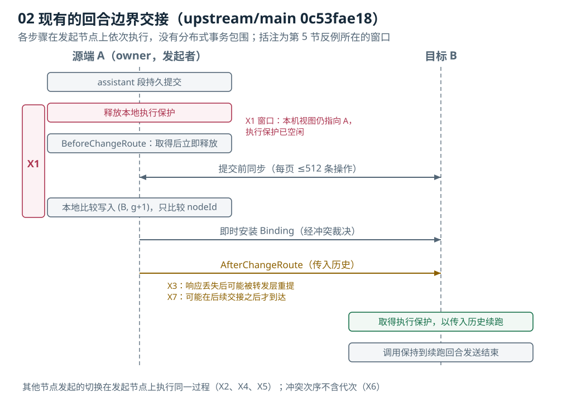
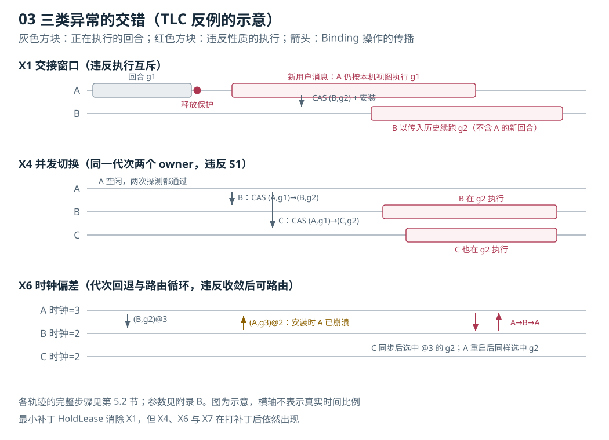
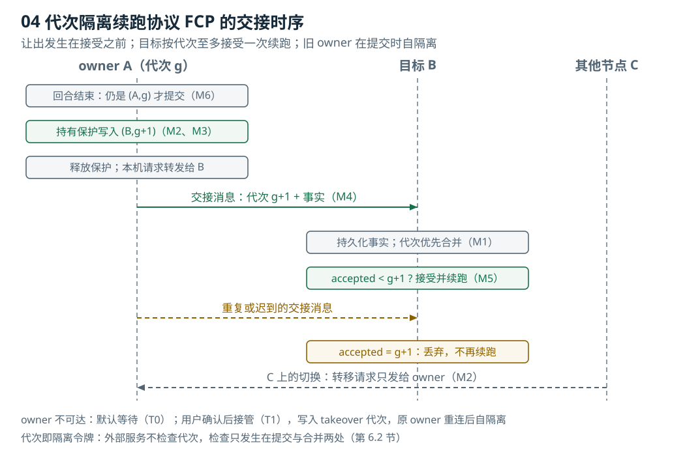

# Operit2 技术白皮书 3.0

<!-- metadata: 中文版 3.0；2026-11-10；代码基线 upstream/main 0c53fae1811b1731e43a0386bd4f42106fe422e7 -->

## 摘要

LLM Agent 正在从单次对话扩展为跨会话、跨设备的持续工作。Operit2 允许一个会话在回合边界把后续执行从一台个人设备转到另一台，而不迁移进程；回合边界指工具结果已持久化、下一次模型请求尚未开始的时刻。本文研究这种回合边界续跑的正确性。

我们首先说明，回合边界上 Agent 的控制状态已经完全外化为持久事实与有界配置，因此跨设备续跑可以从进程迁移问题降为执行所有权的转移问题。随后我们用 TLA+ 建立形式模型，定义单一推进、交接互斥、事实完整与续跑至多一次等性质，并把每个模型动作对应到 upstream/main `0c53fae18` 的源码。

有界模型检查在当前实现中找到七类反例：交接窗口中的双重执行、同一代次的两个 owner、重复续跑与过期续跑，以及时钟偏差导致的代次回退与路由循环等。只推迟执行保护释放的最小补丁只能消除其中一类。

我们提出代次隔离续跑协议（FCP）：以 Binding 代次作为隔离令牌，只允许 owner 在持有执行保护时让出执行权，按代次幂等地接受续跑，并在提交时自隔离。在 3 个节点、允许崩溃、断链、重复投递与时钟偏差的界限内，TLC 穷举了 6,335,440 个不同状态，没有发现违反上述性质的执行。

模型同时表明，owner 不可达时，“允许接管”与“执行互斥”不能兼得。FCP 默认阻塞，接管交给用户显式确认。在允许接管的配置下，TLC 穷举了 36,017,850 个不同状态，确认所有违规都源于显式接管，并且可以由代次标签识别。本文还讨论了工具的外部效果分类、续跑上下文中环境陈述的失效，以及 `switch_core` 作为一种可被提示注入触发的能力。

所有结论都来自静态源码阅读与有界模型检查。协议尚未实现，故障注入实验尚未执行。

**关键词：** LLM Agent；个人设备空间；执行所有权；隔离令牌；TLA+；模型检查；弱迁移；外部效果

## Abstract

Large language model (LLM) agents increasingly carry one task across sessions and devices. Operit2 lets the execution of a chat move between personal devices at a turn boundary, after tool results are persisted and before the next model request, without migrating processes. This paper studies the correctness of such turn-boundary continuation.

At the boundary, the agent's control state is fully externalized into durable facts and bounded configuration, so cross-device continuation reduces from process migration to the transfer of execution ownership. We formalize the problem in TLA+, define single advancement, handoff exclusion, fact completeness and at-most-once continuation, and map every model action to the source code at upstream commit 0c53fae18.

Bounded model checking finds seven classes of counterexamples in the current implementation, among them double execution in the handoff window, two owners for one generation, duplicate and stale continuations, and generation regression with routing loops under clock skew. A minimal patch that delays the release of the execution lease removes only one of them.

We propose the Fenced Continuation Protocol (FCP). The Binding generation serves as a fencing token; only the owner may relinquish, and only while holding its lease; continuations are accepted at most once per generation; and commits are self-fenced. Within bounds of three nodes with crashes, link cuts, duplicate delivery and clock skew, TLC explored 6,335,440 distinct states without violating these properties.

The model also shows that when the owner is unreachable, takeover and mutual exclusion cannot both hold. FCP blocks by default and leaves takeover to explicit user confirmation. With takeover enabled, TLC explored 36,017,850 distinct states and confirmed that every violation stems from an explicit takeover and is detectable through generation tags. We also discuss effect classes for tools, stale environment claims in transported context, and `switch_core` as a capability that prompt injection can trigger.

All results come from static code reading and bounded model checking. The protocol is not implemented, and no fault-injection experiments have been run.

**Keywords:** LLM agents; personal device space; execution ownership; fencing; TLA+; model checking; weak mobility; external effects

## 文档范围与阅读方式

本文是 Operit2 中文技术白皮书 3.0 版。2.0 版（2026-11-07）系统描述了 Rust Core、Host、持久同步、扩展、平台与安全模型，并用源码证据区分已实现、部分实现与待验证的内容。3.0 不重复这些描述，而是围绕一个问题展开：一个 Agent 会话的执行在个人设备之间转移时，系统能保证什么、不能保证什么。扩展系统、平台矩阵、本地推理与记忆插件，仍以 2.0 为准。

本文的主张按证据类型标注：

| 标注 | 含义 | 证据 |
| --- | --- | --- |
| [A] | 已由原始文献支持的结论 | 参考文献编号，注明适用前提 |
| [C] | 代码事实：基线源码确实如此实现 | 附录 A 的 C 编号，含文件与行号 |
| [T] | 理论推导或有界模型检查的结论 | 推导过程或 TLC 结果，注明界限 |
| [H] | 本文提出的设计假设，尚未实现 | 设计说明与预期性质 |
| [V] | 需要实验判断的命题 | 第 11 节的实验方案 |

[E] 留给在固定环境中实际执行过的测试与实验。本文没有这类证据。

| 读者 | 建议阅读 | 可以据此判断的内容 |
| --- | --- | --- |
| 项目用户与合作者 | 第 1、2、6.5、10、12 节 | 跨设备续跑的能力边界、接管的代价 |
| 开发者与评审者 | 第 2、5、6、7、9 节、附录 A | 现有实现的问题、协议的改动点 |
| 研究者 | 第 1、3、4、5、6、11 节、附录 B | 模型、性质、反例、验证方法与新颖性边界 |

**代码基线：** upstream/main `0c53fae1811b1731e43a0386bd4f42106fe422e7`（2026-11-09）。本文引用的源码文件，在该提交与 dev 分支 `ff663c221` 之间没有差异。所有行号均指向该基线。

**未执行的工作：** 本文没有运行项目的构建、测试或故障注入。模型检查使用 TLC 2.19（tla2tools v1.7.4），这不是项目构建，过程可以按附录 B 复现。

<!-- toc -->

## 1 引言

### 1.1 一个会话，多台设备

用户在手机上让 Agent 整理一个项目的问题清单。Agent 发现需要在桌面电脑的工作区里运行测试，于是调用 `switch_core`，把后续执行交给桌面。桌面上的回合又遇到长时间编译，用户希望它转到一台常在线的 Linux 主机上继续。三台设备都属于用户本人，其中没有一台“服务器”。

每次交接都要回答同一个问题：下一次模型请求由哪台设备发出。答案必须唯一，否则两台设备会同时推进同一个会话，各自调用工具、各自写入历史。交接还要满足几项约束：
- 不能丢失已经提交的工具结果；
- 同一段续跑不能被执行两次；
- 已经离线的设备恢复之后，不能基于过期的认识继续执行。

同时，桌面意外离线时，用户希望还能在手机上继续工作。

Operit2 用 Binding 记录“这个会话的下一次执行由哪个 CoreNode 完成”，并规定交接只发生在回合边界上：工具结果已持久化，下一次模型请求尚未开始[C6]。这一设计避开了迁移进程、终端与浏览器会话的难题。本文要回答的是：做出这一选择之后，剩下的问题是否已经解决。

### 1.2 现有方法为什么不够

**中心协调者不在场。** 本文检索并阅读到的近期跨设备 Agent 系统中，有三个把执行唯一性交给一个中心组件：
- UFO³ 由全局控制平面上的编排 Agent 维护“每个子任务同一时刻至多一个活动分配”[@Zha25]；
- TopoClaw 由中心认知枢纽决定动作在哪台设备上执行[@Hua26]；
- Nexus 由云端在接受执行结果之前检查有时限的执行租约[@Cha26]。

MVVM 则没有讨论这一问题[@Yan25]。个人设备空间的前提恰恰是没有常驻协调者：节点地位对等，副本最终一致，任何一台设备都可能离线。

**数据收敛不等于执行唯一。** CRDT 一类方法保证，收到同一组更新的副本状态等价[@SPBZ11]；本地优先软件把设备上的副本当作主要数据[@KWHM19]。这些性质约束的是数据，而不是由谁执行。两个都认为自己是 owner 的节点，即使最终收敛到同一条 Binding 记录，此前也已经各自发出了模型请求与工具调用。

**经典结论需要重新落地。** 移动 Agent 研究早已指出：复制可以避免阻塞，却可能导致多次执行；在异步系统中，要同时获得非阻塞与 exactly-once，每个阶段都需要一次共识，所依赖的算法要求多数进程正确[@PS03]。租约在时钟偏差有界的前提下可以实现排他[@GC89]；隔离令牌则要求被访问的资源检查令牌[@Bur06]。LLM Agent 会话的执行单位、不确定的模型调用与用户在环，使这些结论不能直接套用。

**LLM 带来新的约束。** 在途的模型请求无法迁移。远程 Provider 的解码状态不在运行时手中，而在数据中心内迁移 KV cache 的方法依赖共享的推理基础设施[@Sun24]。恢复之后，LLM 会重新合成内容不同的请求，服务端的幂等键因此失效[@ACR26]。上下文还夹带着关于执行环境的陈述，换到另一台设备后，这些陈述可能已经不成立[@Tam26]。

### 1.3 本文的贡献

| 编号 | 贡献 | 证据类型 |
| --- | --- | --- |
| C1 | 回合边界续跑的形式模型：状态划分、性质 S1–S5、弱迁移充分性论证、信念—环境一致性定义，以及“接管与互斥不可兼得”的命题 | [T] |
| C2 | 对现有机制的分析：用 TLA+ 模型与源码映射，找出七类异常的最短反例；最小补丁的作用范围 | [T]、[C] |
| C3 | 代次隔离续跑协议 FCP：六项机制、正确性论证、有界模型检查结果、接管策略的安全—可用取舍、实现路径 | [H]、[T] |
| C4 | 外部效果与上下文：四类效果与加强的交接边界；环境差异说明 | [H] |
| C5 | 可复现的评价方法：模型、实验参数、故障注入矩阵与指标 | 方法 |

本文不主张以下几点：提出新的共识算法；保证外部效果 exactly-once；FCP 已经实现；任何未经实测的性能或可靠性数字。本文也不主张“首个跨设备 Agent”，第 3 节说明了已有工作的范围。

### 1.4 方法

本文的证据有四个来源：
- **源码：** 在固定基线上静态阅读交接、路由、Binding、同步与工具准入相关的生产代码；
- **设计意图：** 对照仓库内的设计文档；
- **形式化：** 用 TLA+ [@Lam94] 编写模型，用 TLC [@YML99] 在有界参数下穷举可达状态；
- **文献：** 书目信息经 Crossref 与 arXiv 核验，引用的结论尽量回到原文定位。

“设计中的缺陷经常比代码缺陷更隐蔽”这一判断，与形式化方法在工业系统中的经验一致[@New15]。本文所有反例都是模型层面的反例，它们在真实系统中能否复现，需要第 11 节的实验确认。

## 2 系统模型与现有实现

### 2.1 CoreNode、Space 与 Binding

运行 Operit Core 的一个应用实例就是一个 CoreNode。它由 OperitApplication、LocalCoreProxy 与 HostManager 组成；文件、终端、浏览器与网络能力都来自本机 Host。CoreNode 之间地位对等，监听方与发起方只是一次连接中的角色。Space 是成员、路由与持久复制的范围，它不拥有会话，也不是执行容器。

Binding 把一个业务 key 映射到一个执行节点，记录为 (key, nodeId, generation)[C1]，聊天以 chatId 为 key。比较写入只比较当前的 nodeId 与期望值，成功时代次加一[C1]。Binding 记录作为普通的同步操作在节点之间复制，冲突由通用的操作次序裁决：依次比较 createdAt、originDeviceId 与 sequence，其中 createdAt 取发起设备的墙上时钟[C3]。**代次不参与冲突裁决。** 节点重启时，从本地日志中选出次序最大的操作作为当前 Binding[C2]。

请求在每个节点上独立路由。节点收到带 Binding 注解的调用时，读取本地 Binding：指向自己就本地执行，否则转发给记录中的节点[C5]。因此，“谁在执行”由各节点的本地视图共同决定，而这些视图要等到同步之后才趋于一致（图 1）。

本地执行保护 `ChatExecutionLease` 是进程内的互斥结构，用来拒绝同一聊天的并发执行[C4]。它不跨节点，也不携带可在远端验证的令牌。



### 2.2 持久事实与暂态资源

回合边界上，会话的状态可以分为几类，第 4.3 节给出完整划分：
- **持久事实**：消息、assistant 段、工具调用与结果，经同步复制；
- **执行配置**：参与者、模型覆盖与回合选项，随续跑上下文传递[C7]；
- **节点资源**：工作区挂载、已安装的模型、凭据与 Host 权限，不迁移，由目标节点独立满足；
- **暂态执行**：PTY、WebView、MCP 会话与在途请求，留在源端。

### 2.3 现有的回合边界交接

**源端。** 模型调用 `switch_core` 时，工具只校验目标并返回规范化的节点 ID；真正的切换发生在本轮回合结束之后[C15]。assistant 段提交后，源端依次执行以下步骤[C6, C7]：
- 取出待切换意图；
- 构造续跑上下文 `CoreRouteResumeContext`，内含运行时历史、工作区路径、参与者、模型覆盖与回合选项；
- **释放本地执行保护**；
- 请求切换。

**切换过程。** `changeRoute` 在发起节点上依次执行以下步骤，时序见图 2[C8]：
- 校验目标是 Space 成员、具备 Core 版本与 `runtime.execute` 能力，并且当前可达；
- 在当前 owner 上调用 `BeforeChangeRoute`：取得执行保护后立即释放，以确认“此刻没有在执行”[C10]；
- 与目标执行一轮显式同步，每页至多 512 条操作，单轮页数有上限[C12]；
- 在本地 Binding 存储上做比较写入，代次加一[C1]；
- 把新的 Binding 操作即时安装到目标，安装同样经过冲突裁决[C2, C8]；
- 如果带有续跑上下文，就调用目标的 `AfterChangeRoute`。

**目标端。** `AfterChangeRoute` 打开本地聊天历史，取得执行保护，解析配置，然后使用源端传来的运行时历史开始续跑[C10]。从代码结构看，这次调用要等发送管线结束才返回：发送调用返回之后，才更新 token 统计并通知回合结束[C11]。

用户也可以在任意节点上更改执行设备：`changeChatExecutionDevice` 在该节点上执行同一个 `changeRoute`，只是不带续跑上下文[C9]。owner 资料无法呈现时，`claimMissingBindingLocal` 在本地直接改写 Binding，不续跑进行中的回合[C9]。

实时转发层遇到若干传输错误时，会经另一首跳重提请求。只有 `device.tools` 与 `edge.*` 两类目标被排除在外，理由是“没有回复不等于动作没有执行”[C13]；交接的生命周期调用不在排除之列。



### 2.4 设计意图与实现之间的差距

仓库的架构文档 `docs/core-node-space-binding-architecture.md` 对交接提出了比现有实现更强的要求[C20]：

| 设计要求 | 当前实现 |
| --- | --- |
| 续跑以 `requiredClock` 作为持久同步屏障（§7） | 全仓库没有该标识符；提交前只做一轮带上限的同步，不校验目标的同步水位[C12] |
| 目标按 `(chatId, executionGeneration)` 识别续跑，读取 `completedExecutionGeneration` 防止重复（§7.1） | 字段存在于消息模型与数据库中，生产代码只复制它，不写入实际代次，也不据此判断[C14] |
| 每轮模型请求开始前，确认 Binding 指向自己（§7.1） | 在 `MessageProcessingDelegate`、`ChatServiceCore` 与 `EnhancedAIService` 中未找到逐轮自检；请求在到达的节点上按本地视图路由[C5] |
| Binding 目标不可达时，由发起设备原子接管（§10） | 未找到原子接管；`claimMissingBindingLocal` 只在 owner 资料缺失时做本地改写[C9] |
| 同一聊天的同一执行轮次只能由一个 CoreNode 推进（§10） | 依赖各节点的路由视图与进程内执行保护[C4, C5] |

dev 分支独有的 `docs/compact-boundary-design.md` 把“`BeforeChangeRoute` 改为交接压缩点”标为已实现，但代码中没有这一行为[C10]。同一文档承认“接管校验”尚未实现，“否则会产生分叉窗口”。可见设计文档的状态标注不能作为实现证据。

### 2.5 故障与信任假设

本文考虑以下故障：节点崩溃—停止与重启、消息丢失、重复与乱序、网络分区、移动平台挂起进程，以及设备墙上时钟的偏差。成员节点按非拜占庭处理，这与 2.0 的信任模型一致。2.0 基于 `1ef7884` 的审查指出：PeerLink 逐跳认证加密，中继节点可以读取转发内容，因此中继必须属于用户信任的范围。本文没有在新基线上复核这一点。

对等协议使用单一整数版本，版本不同即拒绝通信（`docs/peer-protocol-versioning.md`）。所以协议变更不需要处理新旧版本混合运行，但需要提升版本号。

## 3 相关工作

### 3.1 中心协调的跨设备 Agent

UFO³ 把用户请求建模为分布在多台设备上的子任务 DAG，由全局控制平面上的编排 Agent 调度。它的不变式要求每个子任务同一时刻至多分配给一台设备；设备断开时，任务被标记为失败并修订 DAG[@Zha25]。TopoClaw 用中心认知枢纽决定“做什么”，用放置引擎决定“在哪台设备上执行动作”；推理不在设备之间迁移，文中也没有讨论断连与执行唯一性[@Hua26]。Nexus 把每次调用当作一个持久任务，由云端保存记录并检查有时限的执行租约；效果状态不确定时，它要求显式的恢复决定，也不保证 exactly-once[@Cha26]。

MVVM 在 WebAssembly 层的稳定点做检查点，实时迁移 Agent 工作区，副本之间只要求最终一致，并允许分区期间暂时分歧[@Yan25]。Unified Agent 研究的是跨设备、跨时间携带的紧凑状态应当如何设计[@Liu26]。边缘场景中的 Agent 放置与迁移以服务质量和时延为目标[@Wan25]。关于与个人数据、个人设备深度集成的 LLM Agent，Li 等人给出了综述[@Li24]。

这些系统都依赖中心协调者，或者不讨论所有权转移的安全性。本文研究的是没有协调者时，对等节点之间的所有权转移。

### 3.2 单机 Agent 的检查点、恢复与效果

AIOS 在单机调度中对生成过程做快照与恢复，用来暂停 Agent 请求[@Mei25]。AgentRewind 对 Agent 上下文与受控环境做对齐的检查点，并允许回退到更早的状态[@Zhu26]。Crab 指出 Agent 框架看得到工具调用、看不到其 OS 效果，存在“语义鸿沟”；它把检查点对齐到回合边界，作者报告超过 75% 的回合不产生与恢复相关的状态[@Wu26]。这为“回合是自然的连续性单位”提供了一个独立的观察。

ACRFence 发现，LLM Agent 恢复之后会重新合成内容略有不同的请求，服务端把它们当作新请求，导致重复付款等后果。它提出记录不可逆效果，并在恢复时执行 replay-or-fork[@ACR26]。Atomix 把工具调用组织为事务，将效果分为可逆、可缓冲与不可逆三类，并明确声明不涉及分布式部署[@Atx26]。Khan 用 TLA+ 形式化了多 Agent 共享存储中的并发异常，其中包括 stale-generation[@Kha26]。该工作的模型是单一逻辑存储、没有复制；它的“generation”指 LLM 的生成过程，与本文 Binding 的代次不是同一概念。

### 3.3 代码迁移与移动 Agent

代码迁移研究区分两种迁移。强迁移把执行单元的代码与执行状态（栈、指令指针）移到另一站点，在那里挂起、传输、恢复。弱迁移不传输执行状态，“即使传输了部分数据状态，执行单元到达后也需要重新开始”[@CPV07]；这一分类最早由 Fuggetta 等人提出[@FPV98]。MAUI 的作者指出，以往的计算卸载要么依赖程序员划分，要么粒度很粗，需要迁移整个进程或虚拟机[@Cue10]。Llumnix 在数据中心的模型实例之间实时迁移请求及其 KV cache，停机时间近乎为零，前提是共享的推理基础设施[@Sun24]。

Pleisch 与 Schiper 在异步系统与崩溃故障的模型下研究移动 Agent 的容错执行[@PS03]。他们指出，复制可以使执行不因单个故障而阻塞，但可能导致多次执行；不可靠的故障检测是违反 exactly-once 的另一来源。他们的方案对每个执行阶段求解一次共识，所依赖的算法需要 ◇S 故障检测器与多数正确进程。

### 3.4 租约、隔离令牌与多数派

租约是在有限期限内授予持有者对某对象特定权利的契约。服务器无法联系持有者时，必须等到租约到期；租约的正确性依赖行为良好的时钟，需要为时钟偏差预留余量[@GC89]。

Chubby 描述了锁本身无法解决的问题：持锁进程发出请求后失效，另一进程取得锁并行动，迟到的请求随后在没有锁保护的情况下被执行。它的 sequencer 包含锁名、模式与锁代次，接收方检查 sequencer 是否仍然有效，否则拒绝请求；对不检查 sequencer 的服务器，则用 lock-delay 降低风险[@Bur06]。Paxos 要求任意两个 ballot 的 quorum 至少有一个公共成员[@Lam98]。在异步模型中，确定性共识不能容忍哪怕一个进程崩溃[@FLP85]；同时保证可用性与原子一致性的读写对象也无法实现，证明的关键是算法无法区分消息丢失与任意延迟[@GL02]。

### 3.5 弱连接复制与本地优先

Bayou 为每次更新附带应用定义的依赖检查与合并过程，把更新分为 tentative 与 committed 两种状态，并采用 primary 提交方案：由一台服务器决定提交顺序，这台 primary 也可以是一台断网的笔记本[@Ter95]。Operit2 的 owner 在角色上接近“每个会话一个 primary”，区别在于 owner 会随交接移动。Coda 的断连操作使客户端在共享存储暂时失效时仍能访问关键数据[@KS92]。CRDT 提供强最终一致性[@SPBZ11]，本地优先提出设备副本为主的七项理想[@KWHM19]，逻辑时钟给出因果偏序[@Lam78]。这些方法关心的是数据，本文关心的是执行。

### 3.6 持久执行与外部效果

Durable Functions 以事件历史保存编排状态，并靠重放恢复。它要求编排代码可以确定性重放，非确定的读取与 I/O 必须包装为 activity，以便记录和重放；文中还指出，存储触发器并不保证 exactly-once[@BGJ21]。Beldi 为有状态的无服务器工作流提供 exactly-once 语义：函数无论崩溃并重启多少次，结果都等价于恰好执行一次[@Bel20]。Temporal 保证 Activity 的完成“只被观察到一次”，但 Activity 可能执行多次，幂等键必须由被调用的服务实施[@Tmp26]。Sagas 用补偿事务处理长事务的部分执行[@GS87]。端到端论证认为，这类功能只能借助端点处应用的知识完整、正确地实现[@SRC84]。

### 3.7 上下文与交接

ReAct 让推理、行动与观察交错进行[@Yao23]。MemGPT 区分主上下文与外部上下文，在接近容量时生成递归摘要[@Pac23]。长上下文中，相关信息位于中部时模型表现显著下降[@Liu24]。Sun 等人报告：直接传递状态的交接保留了全部安全阻断条件，而压缩式交接会反复削弱这些条件[@Sun26]。Tamba 的案例报告中，命令超时被杀后，终端里已经出现的部分输出在压缩摘要中被记为“已完成”；作者把原因归结为“观察与持久的混同”[@Tam26]。

### 3.8 跨设备交互

Brudy 等人对 510 篇跨设备研究论文做了分析与分类[@Bru19]。Dearman 与 Pierce 访谈了 27 人，发现受访者在一项任务中给不同设备分配不同角色，而设备本身并不知道自己的动作属于一个更大的任务[@DP08]。

### 3.9 本文的位置

| 工作 | 协调方式 | 连续性单位 | 执行唯一性 | 外部效果 |
| --- | --- | --- | --- | --- |
| UFO³、TopoClaw、Nexus | 中心编排者、枢纽或云端 | 子任务、动作或调用 | 由中心维护；Nexus 使用租约 | Nexus 要求显式恢复 |
| MVVM | 未明确 | Wasm 执行状态（接近强迁移） | 未讨论 | 未讨论 |
| AgentRewind、Crab、AIOS | 单机 | 检查点 | 不涉及 | 回退与恢复 |
| ACRFence、Atomix | 单机运行时 | 工具调用 | 不涉及 | 效果日志与效果类别 |
| 移动 Agent 容错 | 每阶段共识 | 阶段 | 多数派 | 异常时撤销 |
| **本文** | 对等节点、无协调者、副本最终一致 | 回合边界上的持久事实 | 代次隔离；接管交给用户显式确认 | 效果类别与边界条件 |

在本文的检索范围内（arXiv，检索日期 2026-11-10，检索式见研究记录 `v3/02-literature.md`），没有找到研究“对等设备之间 LLM Agent 会话执行所有权转移的形式化安全性质”的工作。这一判断受检索范围的限制，该领域的进展也很快。

## 4 回合边界续跑的形式模型

### 4.1 状态与动作

考虑单个会话 k，以及 Space 中的节点集合 N。每个节点 n 维护以下状态：
- Binding 操作的持久日志 log(n) 与内存中选中的记录 view(n) = (owner, gen)；
- 已提交事实的持久集合 facts(n)；
- 本地执行保护 lease(n)；
- 执行状态 run(n)：0 表示空闲，否则为正在执行的回合所用的代次。

系统状态还包括在途的生命周期消息，以及环境状态：哪些节点在线、哪些链路断开、各节点的时钟。

动作分为三类：
- **执行动作**：用户发送、回合结束、模型请求切换（`switch_core`）、用户更改执行设备；
- **协议动作**：探测、提交前同步、比较写入、安装、续跑；FCP 另有让出、接受交接、转移请求、接管；
- **环境动作**：同步、崩溃、重启、断链与恢复。

模型的完整定义见附录 B 与 `v3/model/TurnHandoff.tla`。用户发送按逐跳路由解析执行节点：从发送节点出发，沿各节点的 `view.owner` 前进，直到遇到一个视图指向自己的节点，或超出 TTL[C5]。

### 4.2 性质

| 编号 | 性质 | 定义 | 模型中的名称 |
| --- | --- | --- | --- |
| S1 | 代次内单一推进 | 对任意代次 g，g 下的全部执行由同一节点发出 | `SingleGen` |
| S2 | 交接互斥 | 不会在比已开始的代次更旧的代次下开始执行；节点得知自己不再是 owner 之后，不再提交结果 | `NoStaleStart`、`NoUnfencedCommit` |
| S3 | 事实完整 | 代次 g 的每次执行，都能看到所有更早代次的已提交事实 | `FactsComplete` |
| S4 | 续跑至多一次 | 每个代次至多启动一次续跑 | `ContOnce` |
| S5 | 效果可判定 | 恢复后，每个外部效果都可判定为未开始、已完成或显式的未知；系统不自动重做未知的不可幂等效果 | 第 7 节（不在模型内） |
| —— | 执行互斥 | 任一时刻至多一个节点在执行 | `Mutex` |
| —— | 收敛后可路由 | 节点全部在线且连通、日志相同、没有在途消息时，所有节点选中同一条 Binding，并且路由都能解析 | `ConvergedRoutes` |
| L1 | 可接管 | owner 长期不可达时，会话可以在其他节点上继续 | 以 `NoProgressWhileOwnerDown` 的成立或违反作为见证 |
| U1 | 位置可解释 | 节点展示的执行位置等于其视图中的 owner，并标明是否已经得到确认 | 第 10 节 |

### 4.3 回合边界上的弱迁移

| 状态类别 | 例子 | 回合边界上的去向 |
| --- | --- | --- |
| 持久事实 | 消息、assistant 段、工具调用与结果 | 复制；在 FCP 中还随交接传递 |
| 执行配置 | 参与者、模型覆盖、提示类型、回合选项 | 随续跑上下文传递[C7] |
| 位置与授权 | Binding、成员、能力 | 复制与控制面传播 |
| 节点资源 | 工作区挂载、已安装模型、凭据、Host 权限 | 不迁移，由目标独立满足 |
| 暂态执行 | 在途模型请求、PTY、WebView、MCP 会话 | 回合边界上不存在在途请求；其余留在源端 |
| 环境陈述 | “终端 3 中的开发服务器正在运行” | 作为文本随历史迁移，在目标端可能为假 |

回合边界成为合适的交接点 [T]，理由有三。

第一，边界上没有在途的模型请求。在途请求不能重放：输出不确定，会消耗配额，解码状态在远程 Provider 内部，运行时无法取得。数据中心内迁移 KV cache 的方法依赖共享的推理基础设施[@Sun24]，单机内的生成快照依赖本地解码状态[@Mei25]，两者都不适用于远程 Provider。

第二，本轮的工具结果已经持久化，续跑不需要重新执行已完成的工具。

第三，下一次模型请求所需的控制状态就是持久历史加上有界配置，二者都可以复制或随请求传递。

因此交接只需要弱迁移：传输数据状态，执行单元在到达后重新开始[@CPV07]。两端运行同一份运行时代码，连代码也不必迁移。

表的最后一行是弱迁移的代价：迁移的是关于环境的数据，环境本身没有迁移。第 4.4 节给出相应的定义。

### 4.4 信念—环境一致性

设 H 为续跑所用的历史，Claims(H) 为 H 中关于执行环境的陈述，E(t) 为目标节点 t 上可观测的环境。在 t 上续跑满足**信念—环境一致性**，当且仅当对每个 c ∈ Claims(H)，要么 c 在 E(t) 上成立，要么续跑上下文中有一条显式提示，说明 c 可能不成立。

这一要求与 S1–S4 正交：数据完整、执行唯一，并不意味着模型对环境的认识正确。当前实现不满足这一要求 [C]：
- 目标端的续跑请求不附带任何环境说明，`messageText` 为空、`isResume` 为真[C11]；
- `switch_core` 的说明没有列出哪些资源不随迁移[C15]；
- 系统提示只在附件场景下提醒“先检查当前节点”[C18]。

第 8 节给出补救的设计。

### 4.5 接管与互斥不可兼得

**命题 1** [T]　考虑异步消息系统中的两个节点 a 与 b，a 是当前 owner。若协议 P 同时满足以下两条：
- (i) owner 执行回合不需要先与其他节点通信；
- (ii) a 崩溃后，b 在有限步内可以开始执行；

则 P 存在一个执行，其中 a 与 b 同时执行该会话。

**证明草图。** 构造两个执行：在 α 中 a 崩溃；在 β 中 a 存活，但 a 与 b 之间的所有消息都被任意延迟。b 无法区分 α 与 β 的前缀。由 (ii)，b 在 α 中经有限步开始执行，因此在 β 中也会在同样的前缀处开始执行。而在 β 中 a 存活，由 (i) 它仍可以继续执行，于是二者并发。这一论证与 Gilbert 和 Lynch 证明 CAP 定理的思路相同：算法无法区分消息丢失与任意延迟[@GL02]。

命题 1 不是新的理论结果，而是已知不可区分性论证在执行所有权问题上的直接应用。列出它，是为了让第 6.5 节的取舍有明确的依据。

命题 1 给出了三条出路，每一条都有代价 [A][T]：
- **放弃 (ii)，阻塞等待 owner。** 安全，但 owner 长期离线时会话无法继续。
- **放弃 (i)，让 owner 先与多数派确认。** 共识要求任意两个 quorum 相交[@Lam98]，两台设备的空间里多数派就是全部设备，任何一台失效都会阻塞。
- **用租约弱化 (i)。** 需要有界的时钟偏差，并且只能约束“开始执行”与“提交结果”，不能收回租约到期之前已经开始的外部效果[@GC89]。

第 6.5 节在这一取舍之下选择具体策略。

## 5 现有机制分析

### 5.1 方法

模型 `TurnHandoff.tla` 用一个参数 `Proto` 区分两种协议：`current` 抽象 upstream/main `0c53fae18` 的实现，`fenced` 是第 6 节的 FCP。模型中的每个 `current` 动作都对应一段源码，附录 B 列出完整的映射。下面是几处关键的对应：
- 用户发送对应逐跳路由解析[C5]；
- 模型切换对应“提交 assistant 段后释放执行保护”[C6]；
- 探测对应 `BeforeChangeRoute` 的“取得后立即释放”[C10]；
- 比较写入只比较 nodeId[C1]；
- 安装与同步都经过 `(createdAt, originDeviceId)` 的冲突次序[C2, C3]；
- 续跑使用传入历史，并在到达节点上再次按 Binding 路由[C8, C10]；
- 续跑消息可以被重复投递，对应转发层的重提[C13]；
- 重启时从日志中选出次序最大的操作[C2]。

每个实验只打开复现某类异常所需的行为，参数列在附录 B。TLC 按广度优先搜索状态空间，所以给出的反例是该配置下最短的。

### 5.2 七类异常

| 编号 | 名称 | 违反的性质 | 最短反例长度 | 实验 |
| --- | --- | --- | ---: | --- |
| X1 | 交接窗口中的新回合 | 执行互斥 | 10 | `cur_x1_window` |
| X2 | 第三方切换与过期 owner | 执行互斥 | 7 | `cur_x2_thirdparty` |
| X3 | 重复续跑 | S4 | 13 | `cur_x3_duplicate` |
| X4 | 同一代次的两个 owner | S1 | 11 | `cur_x4_samegen` |
| X5 | 续跑历史缺失 | S3 | 8 | `cur_x5_history` |
| X6 | 时钟偏差下的代次回退 | 收敛后可路由 | 17 | `cur_x6_skew` |
| X7 | 过期续跑 | S2（打补丁后为 S4，18 步） | 17 | `cur_x7_stalecont`、`cur_x7_patched` |

最短反例长度由广度优先搜索决定，两次独立运行完全一致。违规实验在找到第一个反例时就停止；由于 8 个 worker 并行搜索，停止前探索的状态数会随线程调度变化，因此本文不报告这一数字。

**X1 交接窗口中的新回合**（2 个节点）。
- 节点 1 的回合调用 `switch_core(2)`，结果提交后，执行保护被释放[C6]。
- `BeforeChangeRoute` 探测节点 1：空闲，通过。
- 节点 1 上来了一条新的用户消息。本地 Binding 仍指向节点 1，发送入口只以执行保护作互斥[C19]，于是节点 1 以 g1 开始新回合。
- 提交前同步完成；节点 1 本地写入 (2, g2)，并安装到节点 2。
- 节点 2 收到 `AfterChangeRoute` 并开始续跑，与节点 1 并发。节点 2 续跑所用的历史里，没有节点 1 新回合的内容。

**X2 第三方切换**（3 个节点）。节点 2 上的用户把执行设备改为节点 2。探测通过之后，节点 1 上的用户又发了一条消息，节点 1 开始执行。节点 2 本地写入 (2, g2) 后，节点 2 上的新消息也在节点 2 执行。节点 1 的视图要等同步之后才会改变，两个节点并发。

**X3 重复续跑**（2 个节点）。1→2 的交接完成，节点 2 的续跑开始并结束。之后 `AfterChangeRoute` 被再次投递：在多路径拓扑中，响应丢失后，转发层会经另一首跳重提[C13]。此时节点 2 的执行保护已经空闲，于是用同一份传入历史第二次续跑，模型请求与工具调用随之重复。这一结论不依赖生命周期调用在何时返回[C11]：只要重复的请求在第一次续跑释放执行保护之后到达，第二次续跑就会执行。

**X4 同一代次的两个 owner**（3 个节点）。节点 2、3 上的用户先后把执行设备改为各自所在的节点。两次探测都看到节点 1 空闲，两次比较写入都基于 (1, g1)，分别得到 (2, g2) 与 (3, g2)。两边随后都在 g2 下执行。可见代次不是全网唯一的执行身份。

**X5 续跑历史缺失**（3 个节点）。节点 1 的回合结束并提交了事实，随后节点 2 上的用户把执行设备改为节点 2。提交前同步只发生在发起者与目标之间，这里二者都是节点 2，节点 1 的事实没有同步过来，所以节点 2 在缺少它的情况下开始执行。

**X6 时钟偏差下的代次回退**（3 个节点，打补丁）。节点 1 的时钟为 3，节点 2、3 的时钟为 2。
- 节点 1 把执行交给节点 2：记录 (2, g2)，createdAt = 3。
- 节点 2 又交回节点 1：记录 (1, g3)，createdAt = 2。
- 安装 g3 时节点 1 已经崩溃。节点 3 同步之后，按 createdAt 选中 g2；节点 1 重启后，从日志中同样选出 g2[C2, C3]。
- 最终三个节点的日志相同，但节点 1、3 认为 owner 是节点 2，节点 2 认为 owner 是节点 1。路由在节点 1、2 之间循环，会话不可达，代次也从 g3 回退到了 g2。

**X7 过期续跑**（3 个节点）。第一次交接 1→2 的 `AfterChangeRoute` 在途中被延迟。第二次交接 1→3 先完成，节点 3 以 g3 开始续跑。迟到的第一条消息随后到达节点 2，节点 2 的视图仍是 g2，于是在旧代次下开始执行。打补丁后的变体里，迟到的消息按 Binding 被路由到当前 owner，用第一次交接的旧历史又启动了一次 g3 续跑。

图 3 画出了 X1、X4 与 X6 的交错。



### 5.3 最小补丁的作用范围

一个直观的修补是让源端持有执行保护，直到 Binding 提交之后再释放，从而关闭 X1 的窗口。在模型中把这个补丁记为 `HoldLease`：
- 在 X1 的配置下，TLC 穷举完成，没有发现违规（57 个不同状态），说明补丁确实关闭了这个窗口 [T]；
- X6 与 X7 的反例，都是在打开补丁的条件下得到的；
- X2–X5 与这个窗口无关。

所以，单靠调整释放时机得不到 S1–S4。根本原因有三点：
- Binding 的写入不局限于 owner；
- 代次不参与冲突裁决；
- 续跑消息不携带、也不校验代次。

### 5.4 这些反例对真实系统意味着什么

这些反例说明，模型中的交错是可能发生的，但它们在真实系统中出现的条件差别很大：
- **X1**：需要源端在提交前同步期间收到同一聊天的新发送请求。运行时另有一个 `steerMessage` 接口，用来向仍在运行的回合追加引导，回合结束时引导队列被关闭[C22]。界面在会话运行时是否改用这个接口，本文没有核实；如果改用，单一界面下的概率会降低。直接调用发送接口的客户端，例如同一设备上的 CLI、另一个窗口，或经路由到达的请求，只受执行保护约束[C19]。
- **X2、X4**：需要用户在另一台设备上更改执行设备，而 owner 恰好空闲。
- **X3**：需要多路径拓扑，以及续跑结束后的响应丢失。
- **X5**：需要发起者缺少 owner 最新提交的事实。
- **X6**：需要两次交接之间的间隔小于设备时钟偏差，并且发生崩溃或安装失败。
- **X7**：需要生命周期消息被显著延迟。

后果包括：同一会话的双重执行，即模型请求与工具效果重复；历史分叉；续跑丢失；路由循环导致会话不可达。本文不把它们称为“已确认的缺陷”。它们是有依据的候选反例，可以用第 11.2 节的实验逐一确认或排除 [V]。

## 6 代次隔离续跑协议 FCP

### 6.1 设计约束

FCP 的设计受四条约束：
- **便利优先。** owner 可达时，常见路径不得增加任何用户步骤。
- **不静默回退。** 任何可能破坏执行互斥的操作，都必须显式发生并且可以追溯；不能在超时后自动接管。
- **不引入新概念。** 架构文档明确不引入 Lease、Placement 等概念[C20]。FCP 复用三样已有的东西：Binding 的代次作为隔离令牌，进程内执行保护，以及数据库中已有的 `completedExecutionGeneration` 字段[C14]。
- **可以升级。** 对等协议要求版本相同才能通信，FCP 随协议版本升级一起发布，不需要兼容新旧混合运行。

### 6.2 机制

| 机制 | 内容 | 消除的异常 |
| --- | --- | --- |
| M1 代次优先合并 | Binding 冲突次序改为 (generation, createdAt, originDeviceId, sequence)；即时安装与重启重建使用同一次序 | X6 |
| M2 只有 owner 能让出 | 只有本地视图显示自己是 owner 的节点，才能写入下一代次；其他节点发起的切换，变成发给 owner 的转移请求 | X2、X4、X5 |
| M3 持有保护让出 | owner 在仍持有执行保护时写入 (target, g+1)，之后才释放；此后源端的本地请求按新 Binding 转发 | X1 |
| M4 事实随交接传递 | 交接消息携带 owner 在让出时已提交的事实（或其水位），目标端先持久化这些事实，再开始续跑 | X5，S3 |
| M5 按代次幂等续跑 | 交接消息携带代次；目标端持久记录已接受的最高代次，只有在“视图中的 owner 是自己、代次等于消息代次、尚未接受过”时才开始续跑 | X3、X7 |
| M6 提交时自隔离 | 回合结果只在节点仍是该代次 owner 时提交，否则丢弃并标记 | 分区与接管下的 S2 |

M1 与 M6 合起来，就是 Chubby sequencer 思想在 Agent 运行时上的落地：代次是令牌，检查放在运行时自身[@Bur06]。外部模型服务与第三方 API 不会检查 Operit2 的代次，所以检查点只能设在两处：每次提交结果时，以及每次合并 Binding 时。M5 是设计文档 §7.1 中“按 (chatId, executionGeneration) 识别续跑”的实现形式。图 4 给出 FCP 的交接时序。



### 6.3 正确性论证

以下论证针对不允许接管的情形 [T]。

**引理 1（代次的创建者唯一）。** 对任意 g，至多有一个节点创建代次 g+1 的操作。由 M2，只有 g 的 owner 能创建 g+1；由 M3，owner 创建 g+1 之后，自己的视图立即变为 (t, g+1)，不再是 owner。g 的 owner 本身唯一（对 g 归纳，g = 1 时只有初始节点）。因此 g+1 的创建者唯一。

**引理 2（让出先于接受）。** 目标只有收到交接消息才可能成为 g+1 的 owner，而交接消息在 g 的 owner 写入让出之后才发出（M3）。

**引理 3（视图单调）。** 由 M1，节点一旦得知 g+1，就不会再选中 g 或更早的代次，重启之后也是如此。

由此可以得到四条性质：
- **S1**：由引理 1，每个代次只有一个 owner；而只有 owner 能开始执行，因为路由解析在视图指向自己的节点上停止。
- **S2**：由引理 2、引理 3 与 M6，旧 owner 让出之后不再开始执行，也不再提交结果。
- **S4**：由 M5 直接得到。
- **S3**：g 及更早代次的事实，在让出时全部位于 g 的 owner 上。g 的事实只能由 g 的 owner 提交；更早代次的事实，在该 owner 接受交接时已经随交接持久化（M4，对 g 归纳）。这些事实随交接传递，此后再也没有更早代次的事实被提交（M6）。

上述论证没有用到时钟同步，所以时钟偏差只影响同代次内的次序，不影响安全性。这只是证明草图；第 6.4 节的有界模型检查作为补充证据。

### 6.4 模型检查结果

| 实验 | 设置 | 结果 |
| --- | --- | --- |
| `fen_safe` | 3 个节点；模型切换与用户切换都打开；允许时钟偏差、1 次崩溃、1 次断链、1 次重复投递；不允许接管 | 8 条性质全部成立：收敛后可路由、执行互斥、S1、S2 的两项、S3、S4，以及“owner 下线时无进展”。共生成 34,499,016 个状态，其中不同状态 6,335,440 个，最大深度 21，用时 4 分 08 秒 |
| `fen_takeover_mutex` | 同上，允许用户接管 | 执行互斥被违反（4 步）：节点 1 执行中，链路 1–2 断开，节点 2 的用户确认接管 |
| `fen_takeover_progress` | 同上 | “owner 下线时无进展”被违反（3 步）：节点 1 崩溃，节点 2 接管并开始执行 |
| `fen_takeover_safe` | 同上，检查接管下的可检测性 | 4 条性质全部成立：一个代次由两个节点推进的情形，只出现在某次接管之后；节点得知自己被取代后，不再提交结果；每个缺失的事实都能由一次接管解释；续跑至多一次。共生成 163,747,786 个状态，其中不同状态 36,017,850 个，最大深度 22，用时 21 分 24 秒 |

这些结论只在附录 B 的界限内成立：N = 3，代次至多 3，发送至多 2 次，交接至多 2 次，崩溃与断链各至多 1 次，重复投递至多 1 次。它们是有界模型检查的结果，既不是对任意规模的证明，也不是对实现的验证。

### 6.5 接管策略

| 策略 | 执行互斥 | owner 长期不可达时 | 前提 | 代价 |
| --- | --- | --- | --- | --- |
| T0 等待 | 成立 | 阻塞 | 无 | 可用性 |
| T1 用户确认接管 | 分区期间可能被破坏，但可以检测 | 可以继续 | 用户在场，并理解风险 | 可能出现分叉，需要人工处理 |
| T2 见证多数 | 成立 | 多数在线时可以继续 | 至少 3 个能投票的节点；每次推进都要与多数通信 | 每个回合的通信开销；两台设备时退化为 T0 |
| T3 租约 | 在时钟偏差有界时成立 | 租约到期后可以继续 | 有界时钟偏差；owner 在每个执行步之前检查租约 | 已经开始的外部效果无法收回；引入了架构文档排除的 Lease 概念 |

FCP 采用 T0 作为默认策略，T1 作为显式选项。理由是个人设备空间通常只有两三台设备，T2 在这种规模下多数时候等同于 T0；T3 需要时钟假设，并违反项目约束。

默认的 T0 并不比现状更不可用。在现有实现中，owner 不可达时，`changeRoute` 对它的 `BeforeChangeRoute` 调用会失败，切换无法进行；普通请求也必须路由到 owner[C8, C5]。T1 是新增的能力。owner 永久离开 Space 的情形（设备被移除或丢失）同样归入 T1：现有的 `claimMissingBindingLocal`，即 owner 资料缺失时的本地改写[C9]，由带 takeover 标记的接管取代，这样它产生的新代次可以被识别。

T1 的语义是：用户确认“原设备可能仍在执行，我接受由此可能产生的分叉”。接管写入一个标记为 takeover 的新代次。原 owner 重新连接后，由于 M1，它会得知更高的代次；由于 M6，它不再提交结果。它在接管之后提交的事实带有旧代次标签，因此可以识别为分叉分支，并交给用户处理。若空间中有一台常在线的节点，T2 可以作为未来的扩展：要求接管获得包括该节点在内的多数确认。

### 6.6 实现路径

| 机制 | 改动位置 [C] | 说明 |
| --- | --- | --- |
| M1 | Binding 域的冲突次序：`SyncOperationOrder::fromOperation` 与 `materializeBindingRecords`[C2, C3] | 只针对 Binding 域把代次放到最前，不影响其他数据域 |
| M2 | `changeRoute` 与 `changeChatExecutionDevice`[C8, C9] | 非 owner 不再本地写入，而是向 owner 发送转移请求；owner 不可达时返回明确的错误，或进入 T1 |
| M3 | `releaseExecutionForRoute` 的调用顺序[C6] | 改为在 Binding 提交之后释放 |
| M4、M5 | `AfterChangeRoute` 的参数与目标端的 `resumeFromRouteContext`[C10]；`completedExecutionGeneration`[C14] | 交接消息携带代次与事实水位；目标端持久记录已接受的代次 |
| M6 | assistant 段的持久提交路径[C6] | 提交前检查本地 Binding 仍为 (self, 回合代次) |
| T1 | 新的接管接口与界面确认 | 见第 10 节 |
| 协议版本 | `core/peer-protocol.json` | 交接消息与 Binding 次序都会变化，需要提升协议版本 |

这些改动属于设计层面的映射，尚未实现，也未经测试 [H]。

## 7 外部效果与交接边界

### 7.1 问题

交接与故障恢复都会遇到同一个窗口：外部效果已经发生，而记录还没有持久化。Temporal 明确指出，Activity 可能被执行多次，幂等键要由被调用的服务实施[@Tmp26]。LLM Agent 还有一层额外的困难：恢复之后，模型会重新合成内容不同的请求，服务端的幂等键因此认不出重复[@ACR26]。现有实现已经部分认识到这一点：转发层不对 `device.tools` 与 `edge.*` 自动重提[C13]。但工具效果只分 `READ` 与 `WRITE` 两档[C17]，交接边界也没有考虑效果的状态。

### 7.2 四类效果

| 类别 | 定义 | 重试 | 交接边界上的要求 |
| --- | --- | --- | --- |
| E0 观察 | 不改变外部状态 | 可以 | 结果可能已经陈旧（第 8 节） |
| E1 幂等 | 带有运行时分配的效果身份；重复执行与执行一次等价 | 可以，但必须重用同一身份 | 身份与状态已持久化 |
| E2 可补偿 | 存在已知的补偿操作 | 不自动重试；失败时补偿 | 补偿信息已持久化 |
| E3 不可逆 | 付款、发信、设备动作等 | 永不自动重试 | 状态必须是“已完成”或“已确认失败” |

这一分类与 Atomix 的效果类别[@Atx26]、Sagas 的补偿[@GS87]一致 [H]。还需要两条规则。

**规则 1：** 效果身份在调用之前由运行时分配并持久化，不能从模型重新生成的请求中推导。交接时，效果身份随事实一起传递，目标端不得为同一意图分配新的身份。

**规则 2：** 加强交接边界的定义。原定义是“工具结果已持久化、下一次模型请求尚未开始”，现在改为：

> 工具结果已持久化、所有 E3 效果的状态已确定、下一次模型请求尚未开始。

一次超时的 E3 调用，即使已经记录了“超时”这个结果，其效果状态仍然未知，不构成可以自动交接的边界，需要交给用户确认。

### 7.3 局限

效果类别需要工具的元数据来声明，第三方 MCP 服务与插件未必提供准确的声明。E3 状态的确定往往依赖外部服务提供的查询接口。端到端论证提醒我们，这类保证最终只能由端点上的应用完成[@SRC84]，运行时能做的是不制造新的重复，并把不确定性暴露给用户。

## 8 上下文连续性

### 8.1 交接时不做压缩

架构文档规定，切换 CoreNode 时直接携带当前运行上下文，不触发会话总结或上下文压缩[C20]，当前实现也与之一致[C10]。这一选择有独立的实证支持：Sun 等人报告，直接传递状态的交接保留了全部安全阻断条件，而压缩式交接会反复削弱这些条件[@Sun26]。长上下文本身也有代价，相关信息位于中部时模型表现下降[@Liu24]；但这是一个预算问题，应由独立的压缩策略处理，不应与交接耦合。

### 8.2 环境差异说明

为满足第 4.4 节的信念—环境一致性，我们提出一项设计假设 [H]：续跑开始时，由运行时生成一条结构化的环境差异说明，作为续跑上下文的一部分。说明包含以下内容：
- 执行节点从 A 换到了 B；
- 源端仍持有、不随迁移的会话资源，例如终端会话、浏览器会话与 MCP 会话；
- 工作区路径在 B 上能否解析，相关文件在 B 上的版本是否与源端一致；
- 外部效果中仍处于未知状态的调用。

这些信息由运行时掌握，模型无从得知。这与 Tamba 报告的“观察与持久的混同”相对应：终端里出现过的输出不等于已经持久化的结果[@Tam26]。同理，源端可见的资源也不等于目标端可见的资源。

### 8.3 摘要中的观察

压缩摘要如果把未经持久化证实的观察写成事实，跨设备续跑会放大这一错误，因为目标端更难核实源端的观察。对摘要提出一项要求：摘要应区分“已持久化的事实”与“曾经观察到的输出”，并保留工具调用的退出状态 [H]。

## 9 安全：交接作为一种能力

### 9.1 由提示注入触发的执行迁移

`switch_core` 会改变后续工具在哪台设备的 Host 上执行，其注册效果为 `WRITE`[C15]。现有 AI 准入对它的处理按模式不同[C16, C21]：
- ReadOnly 模式下需要审批；
- WorkspaceWrite 模式下，非文件类 `WRITE` 需要审批，但会话级批准按工具名记录，批准一次后，此后切到任何目标都不再询问；
- Full 模式不审批。

间接提示注入可以操纵应用的功能，控制“是否以及如何调用其他 API”[@Gre23]。因此，被注入的指令可以把执行迁到权限更高的设备上，例如一台可以运行终端命令的桌面。按最小特权与完全仲裁原则，每次访问都应检查权限[@SS75]，交接的审批范围应当包含目标设备：会话级批准针对 (switch_core, 目标节点) 记录，切到新的目标时重新询问 [H]。

### 9.2 交接内容的可见性

FCP 的交接消息携带事实（M4）。在多跳路径上，中继节点作为逐跳加密信道的端点可以读取这些内容（2.0 基于 `1ef7884` 的审查，§10.4）。这与现有的历史传递没有本质区别，因为源端历史本来就随请求传递，但它扩大了经过中继的数据量。在需要对中继保密的部署中，交接可以只携带水位，事实由目标端通过同步自行拉取。代价是续跑开始前需要等待这一轮同步。

### 9.3 撤销与交接

成员撤销通过控制面传播，存在延迟。被撤销的节点可能仍然持有指向自己的 Binding。在 FCP 中，接受交接时检查目标的成员资格与 `runtime.execute` 能力，可以防止把执行交给已被撤销的节点。但已被撤销、却仍自认为是 owner 的节点，在得知撤销之前仍可能执行。这与命题 1 的结构相同，只能靠控制面传播与 M6 的提交时检查来缩短窗口。

## 10 执行位置的人机界面

用户需要知道会话在哪里执行、交接是否完成，以及系统在哪些方面并不确定。跨设备研究指出，设备并不知道自己的动作属于一个更大的任务[@DP08]，而跨设备交互的设计空间已经相当成熟[@Bru19]。第 4.2 节的性质 U1 要求界面展示的执行位置与节点视图一致，并标明该信息是否已经确认。我们提出以下状态集合 [H]：

| 状态 | 含义 | 界面需要说明的内容 |
| --- | --- | --- |
| 在本机执行 | 本机视图指向本机 | —— |
| 在设备 X 执行（已确认） | 本机视图指向 X，且 X 已接受当前代次 | 设备名与平台 |
| 在设备 X 执行（未确认） | 本机视图指向 X，但尚未收到 X 的确认 | 信息可能过期 |
| 交接中 | 已经让出，目标尚未接受 | 不可重复发送 |
| 等待设备 X | X 不可达，会话被阻塞（T0） | 可以选择接管，并说明接管的风险 |
| 已接管 | 本机写入了 takeover 代次 | 原设备可能仍在执行 |
| 发现分叉 | 收到带旧代次标签、却在接管之后提交的事实 | 需要用户选择保留哪条分支 |
| 效果状态未知 | 存在未确定的 E3 效果 | 需要用户核实 |

接管的确认文字应当直接写出代价，例如：“设备 X 可能仍在执行这个会话，继续可能产生两份结果”。不能用“继续”这类模糊的按钮替代。

## 11 评价方法

### 11.1 已完成的部分

已完成的部分是对当前协议与 FCP 的有界模型检查（第 5、6 节），共 13 个实验。全部参数、命令、工具版本与校验和见附录 B。除 `fen_safe`（4 分 08 秒）与 `fen_takeover_safe`（21 分 24 秒）外，每个实验都在 10 秒内完成。

### 11.2 待执行的故障注入矩阵

每类异常对应一个可以在真实系统中执行的实验 [V]。仓库已有多进程运行器与带故障注入的契约测试（2.0 §11.1），可以作为起点。按项目约定，每次运行都需要事先得到授权。

| 异常 | 设置 | 注入 | 观测 | 判定 |
| --- | --- | --- | --- | --- |
| X1 | 两个节点；源端同时有 Flutter 界面与 CLI 客户端 | 在 `releaseExecutionForRoute` 之后、比较写入之前，从 CLI 发送一条消息 | 两端的执行日志与模型请求计数 | 出现并发回合，即确认 X1 |
| X2 | 三个节点 | 在 `BeforeChangeRoute` 返回之后，于原 owner 上发送消息 | 同上 | 同上 |
| X3 | 三个节点，形成多路径 | 续跑结束后丢弃 `AfterChangeRoute` 的响应 | 目标端的续跑次数、外部计数器 | 出现两次续跑，即确认 X3 |
| X4 | 三个节点 | 在两个非 owner 上并发调用 `changeChatExecutionDevice` | 两条 Binding 记录的 owner 与代次 | 出现同代次、不同 owner 的两条记录 |
| X5 | 三个节点 | owner 的回合结束后立即在第三方节点发起切换，并阻断 owner 的后台同步 | 目标首个请求的历史 | 缺少 owner 最新提交的事实 |
| X6 | 三个节点，人为设置时钟偏差 | 在两次快速交接之间造成安装失败并重启 | 各节点选中的 Binding，路由结果 | 出现代次回退或路由循环 |
| X7 | 三个节点 | 延迟第一次交接的 `AfterChangeRoute`，直到第二次交接完成 | 续跑所用的代次与历史 | 出现旧代次或旧历史的续跑 |

对外部效果，用一个可观测的外部计数服务记录每次调用，并区分四个数：调用次数、成功的副作用次数、已持久化的完成次数、用户观察到的结果。

### 11.3 指标

| 指标 | 定义 | 控制条件 |
| --- | --- | --- |
| 交接时延 | 从源端提交 assistant 段，到目标端发出首个模型请求的时间 | 区分同步、确认与模型网络时间 |
| 双重执行率 | 同一会话出现并发回合的试验所占比例 | 外部独立计数 |
| 重复效果率 | 同一意图产生一次以上外部效果的比例 | 覆盖“成功后丢失响应”与崩溃窗口 |
| 阻塞时长 | T0 下，owner 不可达到恢复之间会话无法推进的时间 | 记录故障类型 |
| 分叉率 | T1 下，接管后出现旧代次事实的比例 | 记录分区时长 |
| 收敛时间 | 交接完成后，所有节点视图一致所需的时间 | 固定拓扑与同步周期 |
| 失效信念行动率 | 续跑后的模型行动中，基于不再成立的环境陈述的比例，例如对已不存在的终端会话发送命令 | 构造带标注的交接任务（源端有暂态资源，目标端没有）；对照有无环境差异说明两组；固定模型与提示 |

### 11.4 有效性威胁

- **模型保真度。** 模型省略了回合内部结构、同步分页与 RPC 的中间状态（附录 B）。
- **界限。** 更大的规模可能暴露新的交错。
- **映射。** 动作与源码的对应由人工完成，存在遗漏其他入口的可能。
- **新颖性判断。** 受检索范围与日期的限制。
- **设计假设。** FCP、效果分类与环境差异说明都尚未实现，其成本与可用性只能由实现与实验评估。

## 12 讨论与局限

**更简单的替代方案。** 第一种是“任何时候都必须由 owner 确认”，即 T0 加上 M2：它已经消除了 X2、X4、X5，但仍需要 M1、M5 处理时钟偏差与续跑重复。第二种是引入一台中心服务器保存 Binding，这违背设备空间无中心的前提，也会把可用性绑定在这台服务器上。第三种是借鉴 Bayou 的 primary，为每个会话固定一个提交节点[@Ter95]，这等价于禁止执行迁移。FCP 保留了迁移能力，代价是本文给出的六项机制。

**规模与信任。** 本文面向小规模的个人设备空间，没有分析大量节点或多租户场景。成员与中继被视为非拜占庭；被攻陷的设备可以伪造代次或事实，FCP 不防御这类攻击。

**未解决的问题。** 有三个问题尚未解决：
- T1 产生分叉之后，如何帮助用户合并两条分支；
- E3 效果的状态如何在不依赖外部服务查询接口的情况下确定；
- 环境差异说明能在多大程度上减少模型基于失效信念的行动，这需要标注数据与对照实验来回答。

**未建模的部分。** 架构文档要求响应流属于用户发起的那次执行，由最初接受请求的路由器维持上游流，交接后由新的执行节点继续写入同一条流（§7.2）。本文的模型没有包含这一流的连续性；交接与重复续跑会对用户看到的输出造成什么影响，需要另行分析。

**与 2.0 的关系。** 2.0 已经指出，本地比较写入与代次不是全网可验证的隔离令牌，并把“任务接管、操作意图与外部效果之间的可验证关系”列为首个开放问题。本文把这一问题形式化，给出具体的反例与协议。但本文的分析仍局限于执行所有权，同步、扩展、平台与记忆等子系统的评价仍需要独立的研究。

## 13 结论

回合边界让 LLM Agent 的跨设备续跑免去了进程迁移：边界上的控制状态完全落在持久事实与有界配置之中。剩下的问题是执行所有权的转移。这个问题在没有中心协调者、副本最终一致的个人设备空间中并不平凡。

Operit2 当前的实现依靠各节点的本地视图、进程内的执行保护与交接前的同步来维持单一执行。有界模型检查给出了七类违反该目标的最短反例，只推迟保护释放的补丁只能消除其中一类。FCP 以代次作为隔离令牌，在模型的界限内同时满足单一推进、交接互斥、事实完整与续跑至多一次。

模型同时表明，owner 不可达时的接管与执行互斥不能兼得。一个面向个人用户的系统，应当把这一取舍交给用户显式选择，并让由此产生的分叉可以被识别。数据完整也不等于模型对环境的认识正确；交接需要附带由运行时生成的环境差异说明。

这些结论有待实现与实验检验，第 11 节给出了相应的方法。

## 附录 A 源码证据

基线为 upstream/main `0c53fae18`。链接指向该提交的源码。

| 编号 | 位置 | 内容 |
| --- | --- | --- |
| C1 | [CoreNodeBindingStore.rs:84-95, 180-211](../../../core/crates/persistence/store/src/CoreNodeBindingStore.rs#L180-L211) | Binding 记录 (key, nodeId, generation)；`compareAndSet` 在进程内全局互斥下只比较 `expectedNodeId`，目标改变时代次加一 |
| C2 | [CoreNodeBindingStore.rs:215-320](../../../core/crates/persistence/store/src/CoreNodeBindingStore.rs#L215-L320) | 同步应用与即时安装都经过 `shouldApplyOperation`；`materializeBindingRecords` 从日志中选出次序最大的操作 |
| C3 | [SyncOperationStore.rs:292-326, 1060-1091, 1816](../../../core/crates/persistence/store/src/SyncOperationStore.rs#L292-L326) | `SyncOperationOrder` = (createdAt, originDeviceId, sequence)；`shouldApplyOperations` 按该次序裁决；本地操作的 createdAt 取 `currentTimeMillis()` |
| C4 | [ChatExecutionLease.rs:21-27, 111-154](../../../core/crates/persistence/store/src/ChatExecutionLease.rs#L111-L154) | 进程内执行保护，拒绝同一聊天的并发执行 |
| C5 | [CoreNodeRouter.rs:976-1024](../../../core/crates/node/runtime/src/CoreNodeRouter.rs#L976-L1024) | `callSpaceWithOrigin`：在到达的节点上解析本地 Binding，本地执行或转发 |
| C6 | [MessageProcessingDelegate.rs:987-994, 2642-2700](../../../core/crates/runtime/application/src/services/core/MessageProcessingDelegate.rs#L2642-L2700) | assistant 段提交后取出切换意图、构造续跑上下文、释放执行保护、请求切换 |
| C7 | [runtime_support.rs:21-35](../../../core/crates/tool/services/src/runtime_support.rs#L21-L35) | `CoreRouteResumeContext` 的字段 |
| C8 | [RuntimeRemoteLinkService.rs:944-1166](../../../core/crates/node/runtime/src/RuntimeRemoteLinkService.rs#L944-L1166) | `changeRoute` 的校验、探测、同步、比较写入、安装与 `AfterChangeRoute`；生命周期调用经 `callNodeSpace` 发送 |
| C9 | [RuntimeRemoteLinkService.rs:892-940](../../../core/crates/node/runtime/src/RuntimeRemoteLinkService.rs#L892-L940) | `claimMissingBindingLocal`；`requestChangeRoute` 与 `changeChatExecutionDevice` |
| C10 | [ChatServiceCore.rs:796-890](../../../core/crates/runtime/application/src/services/ChatServiceCore.rs#L796-L890) | 目标端以传入历史续跑；`beforeChangeRoute` 取得后立即释放执行保护，不做压缩 |
| C11 | [MessageCoordinationDelegate.rs:486-546](../../../core/crates/runtime/application/src/services/core/MessageCoordinationDelegate.rs#L486-L546) | `sendRoutedContinuation` 等待回合发送结束；`messageText` 为空、`isResume` 为真 |
| C12 | [SpacePersistenceSyncService.rs:495-509, 963](../../../core/crates/node/runtime/src/SpacePersistenceSyncService.rs#L495-L509) | 提交前同步，每页操作数上限由 `limit` 传入（切换时为 512） |
| C13 | [route_forwarding.rs:82-86, 113-124](../../../core/crates/node/runtime/src/route_forwarding.rs#L82-L124) | 转发重提策略；`device.tools` 与 `edge.*` 被排除 |
| C14 | [ChatMessage.rs:31](../../../core/crates/foundation/model/src/ChatMessage.rs#L31)、[MessageEntity.rs:28](../../../core/crates/foundation/model/src/MessageEntity.rs#L28)、[ChatHistoryDelegate.rs:145](../../../core/crates/runtime/application/src/services/core/ChatHistoryDelegate.rs#L145) | `completedExecutionGeneration` 字段存在，只被复制 |
| C15 | [ToolRegistration.rs:211-260](../../../core/crates/tool/services/src/tools/ToolRegistration.rs#L211-L260)、[SystemToolPrompts.rs:842-851](../../../core/crates/provider/services/src/chat/config/SystemToolPrompts.rs#L842-L851) | `switch_core` 注册为 `WRITE`，只校验目标并返回规范节点 ID；工具说明 |
| C16 | [AIToolHandler.rs:884-945](../../../core/crates/tool/services/src/tools/AIToolHandler.rs#L884-L945) | 各 AI 模式对 `WRITE` 的审批 |
| C17 | [ToolExecutionManager.rs:776-779](../../../core/crates/tool/services/src/ToolExecutionManager.rs#L776-L779) | `ToolEffect = {READ, WRITE}` |
| C18 | [SystemPromptConfig.rs:555-557](../../../core/crates/provider/services/src/chat/config/SystemPromptConfig.rs#L555-L557) | 附件场景下的节点说明 |
| C19 | [MessageCoordinationDelegate.rs:373, 664](../../../core/crates/runtime/application/src/services/core/MessageCoordinationDelegate.rs#L373)、[ChatTurnTransport.rs:101](../../../core/crates/runtime/application/src/services/core/ChatTurnTransport.rs#L101) | 发送入口以 `beginChatExecution` 作互斥 |
| C20 | [core-node-space-binding-architecture.md](../../core-node-space-binding-architecture.md) | 设计文档：§7 交接与 `requiredClock`、§7.1 单一执行者、§10 约束；第 34–35 行不引入 Lease、Placement |
| C21 | [ToolPermissionSystem.rs:207-250](../../../core/crates/tool/services/src/tools/ToolPermissionSystem.rs#L207-L250) | 会话级批准按工具名记录；没有审批入口时默认拒绝 |
| C22 | [MessageProcessingDelegate.rs:1731-1744](../../../core/crates/runtime/application/src/services/core/MessageProcessingDelegate.rs#L1731-L1744) | `steerMessage`：向仍在运行的回合追加引导，不开启新回合；回合已不在运行或不接受引导时返回错误 |

## 附录 B 模型与复现

**工具与环境。**
- 检查器：TLC 2.19（tla2tools.jar v1.7.4，SHA-256 `936a262061c914694dfd669a543be24573c45d5aa0ff20a8b96b23d01e050e88`）[@TLA174]；
- Java：Microsoft OpenJDK 21；
- 运行环境：Windows 11，8 个 worker，堆内存 7282 MB；
- 搜索方式：广度优先，关闭死锁检查（`-deadlock`）。

**文件。** 全部位于 `v3/model/`：
- `TurnHandoff.tla`：模型；
- `experiments.txt`：实验参数表；
- `cfg/`：由参数表生成的配置；
- `results/`：TLC 的完整输出；
- `run_tlc.sh`：运行脚本；
- `trace_summary.py`：轨迹摘要。

**复现命令。**

```
cd docs/whitepaper/v3/model
TLA2TOOLS=/path/to/tla2tools.jar ./run_tlc.sh            # 全部实验
TLA2TOOLS=/path/to/tla2tools.jar ./run_tlc.sh fen_safe   # 单个实验
python -X utf8 trace_summary.py results/cur_x1_window.log
```

| 实验 | 节点 | 代次上限 | 发送 | 交接 | 崩溃 | 断链 | 重复 | 协议 | 接管 | 模型切换 | 用户切换 | 时钟偏差 | 补丁 |
| --- | --- | --- | --- | --- | --- | --- | --- | --- | --- | --- | --- | --- | --- |
EXPERIMENT_ROWS

**动作与源码的对应。** 各动作的源码出处如下：
- `UserSend`、`Route` 对应 C5；
- `AgentSwitch` 对应 C6；
- `UserChange` 对应 C9；
- `Probe` 对应 C8、C10；
- `PreSync` 对应 C8、C12；
- `CAS` 对应 C1；
- `Install` 对应 C2、C8；
- `SendAfter`、`DeliverAfter` 对应 C8、C10、C11、C13；
- `Recover` 对应 C2；
- 冲突次序对应 C3。

`Relinquish`、`DeliverHandoff`、`DeliverXfer` 与 `TakeoverAt` 属于 FCP，没有对应的现有代码。

**省略的细节。** 模型省略了以下内容：
- 回合内部的多轮模型请求与工具调用；
- 事实的内容与顺序；
- 同步分页与 owner 未就绪；
- 收据中的空洞；
- RPC 的超时与错误码；
- 消息的永久丢失；
- 拜占庭行为。

## 附录 C 术语

| 术语 | 本文的含义 |
| --- | --- |
| 回合边界 | 本轮工具结果已持久化、下一次模型请求尚未开始的时刻；第 7 节将其加强为“E3 效果状态已确定” |
| 执行所有权 | 由谁发出某会话的下一次模型请求；由 Binding 记录，由各节点的本地视图解释 |
| 代次 | Binding 记录中的 generation；FCP 把它用作隔离令牌 |
| 让出 | owner 写入下一代次、把执行权交给目标的操作 |
| 接管 | owner 不可达时，由用户确认、在本机写入新代次的操作 |
| 弱迁移 | 只传输数据状态，执行单元到达后重新开始，不传输执行状态[@CPV07] |
| 信念—环境一致性 | 续跑历史中关于环境的陈述，要么在目标环境中成立，要么附有显式提示 |
| 本地执行保护 | `ChatExecutionLease`，进程内的会话执行互斥 |
| 有界模型检查 | 在给定参数界限内穷举全部可达状态，检查性质是否成立 |

## 参考文献

<!-- references -->
